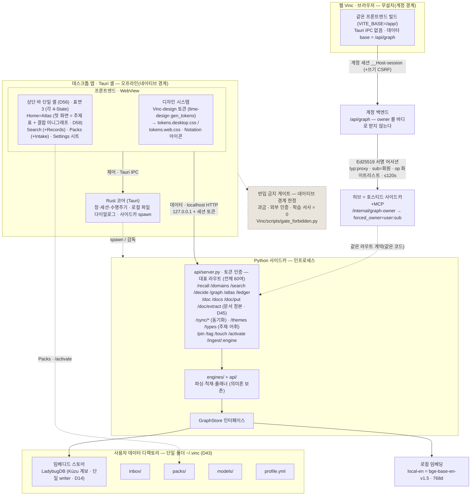
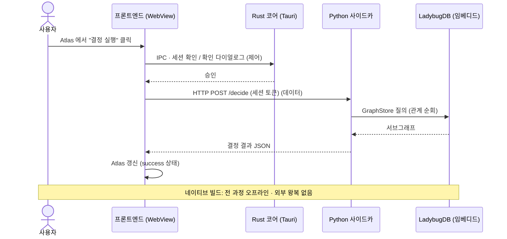
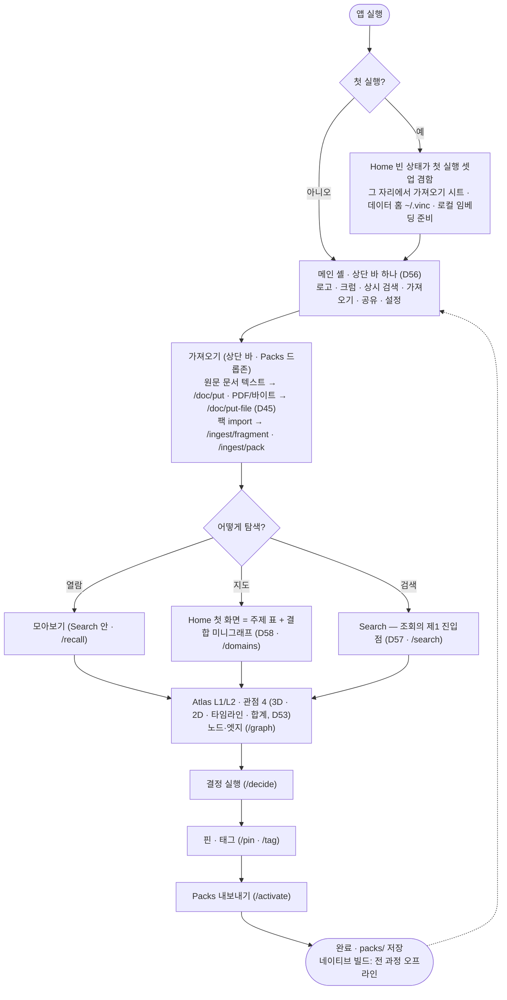

<!-- vinc-export
doc_id: vinc.arch
title: Vinc 아키텍처 · 유저 플로우
origin: Vinc-docs/vinc/ARCHITECTURE.md@5090690
chunks: 6
verified: true
content_hash: cd53a8b72f601cbf3904a9e58792e2586e7cda9798c043337c731c555cc0b298
updated_at: 2026-08-01T16:20:10.040Z
-->

---
doc_id: vinc.arch
layer: C
domain: architecture
title: Vinc 아키텍처 · 유저 플로우 다이어그램
status: draft
authority: SSoT
version: v0.3
owner: vinc
last_updated: 2026-07-29
inherits_from: [vinc.b.architecture]
tags: [vinc, architecture, diagram, mermaid, user-flow]
---

# Vinc 아키텍처 · 유저 플로우

> 오프라인 우선 데스크톱 데이터 마이닝 앱. 제어=Tauri IPC · 데이터=localhost HTTP,
> 사이드카(Python) → GraphStore → 임베디드 스토어(**LadybugDB**, D14 계보) + 로컬 임베딩.
> **같은 프론트엔드가 무설치 웹 Vinc 로도 선다** — 그쪽은 로컬 사이드카 대신 계정 세션 →
> `/api/graph` 프록시 → 서명 어서션 → 허브로 붙는다(§1.1).
> 과금·외부 인증·학습 서사 미반입([[vinc.a.terms]])은 **네이티브 경계의 불변식**이며,
> 웹 빌드는 그 경계 밖에서 계정 세션으로 인증한다(§1.1 · [[vinc.c.web-vincs-app]]).
>
> **v0.3(2026-07-29) 개정:** ① 임베디드 스토어 표기 kuzu → **LadybugDB**(v0.5.3 에서
> 드라이버 단일화, `pyproject.toml` extras `embedded=["ladybug"]`) ② **웹 표면**을 1급으로
> 신설(이 문서에 웹이 한 글자도 없었다) ③ 셸 서술을 D56(레일 폐지 · 상단 바 단일)·
> D58(첫 화면 주제 표)로 갱신 ④ 지식 입력 서술을 D45(문서 정본, [[vinc.c.chunk-ssot]])
> 이후의 **세 경로**로 정정 ⑤ 오프라인 불변식을 네이티브/웹으로 분기 표기
> ⑥ MCP 도구 계약을 실코드(`vinc_mcp/tools.py` 18종)로 정정 — 존재하지 않는
> `vinc_themes_*`/`vinc_types_*` 삭제 ⑦ 디자인 토큰 출처 표기 정정(Ink and Paper →
> Vinc-design 생성 토큰).
>
> **v0.2(2026-07-16) 개정:** 다이어그램이 D7(무암호 단일 프로필)·D14(kuzu-first)·
> D15(5표면+Settings)·D21(전면 3D 렌더러)·§8(local-en 임베딩) 이전 상태로 남아 있어 정정.

## 1. 시스템 아키텍처

### 1.1 두 표면, 하나의 계약 — 네이티브 vs 웹

같은 프론트엔드 소스(`Vinc/app/`)가 두 벌로 선다. **네이티브**는 Tauri 셸 안에서 로컬
사이드카(`127.0.0.1` + 세션 토큰)에 직결하고, **웹 Vinc**는 무설치 브라우저 빌드로
`VITE_BASE=/app/` 만 달리해 데이터 base 를 `/api/graph` 로 돌린다(`app/src/api.ts` 의 `WEB`
분기). **그래프 계약은 같다** — 표면·라우트·페이로드가 동일하고, 다른 것은 인증 경로뿐이다.

- **owner 는 서명된 `sub` 에서만 온다.** 프론트도 계정 백엔드도 요청 바디로 owner 를
  받지 않는다. 계정이 개인키로 어서션(`typ:proxy`·`iss:account`·`aud:mcp`·`op`·≤120s)을
  서명하고, 허브가 계정 **공개키만** 핀해 검증한 뒤 `forced_owner=user:{sub}` 로 강제
  스탬핑한다(바디의 owner 는 `pop` 해 버린다 — `vinc_mcp/http_server.py`
  `graph_owner_request`). 한 회원 세션으로 남의 그래프에 닿을 수 없다(교차테넌트 봉쇄,
  SEC-3 와 이중).
- **op 화이트리스트**(`_PROXY_OPS`)로만 프록시된다. 전역 vocab(`themes`/`types`)·
  동기화 기계(`sync/*`)·로컬 파일(`backup`)은 의도적으로 웹에 노출되지 않는다. 새 라우트는
  사이드카·허브 `_PROXY_OPS`·계정 프록시 허용목록 **세 곳에 동시 등재**해야 하며, 하나라도
  빠지면 그 기능만 웹에서 조용히 죽는다.
- **네이티브는 절대 계정 API 를 호출하지 않는다.** 반입 금지 게이트와 "외부 왕복 없음"은
  네이티브 경계의 불변식이고, 웹 빌드는 그 경계 밖에서 계정 세션으로 인증한다
  (`Vinc/README.md` §경계 불변식). 두 빌드를 구분해서 읽어야 한다.

배포 표면·도메인·CD 파이프라인은 이 문서의 소관이 아니다 — 정본은
`Vinc-docs/vinc/DEPLOYMENT.md`(as-built), 웹 시스템 전체 서술은 [[vinc.c.web-vincs-app]].

## 2. 제어(IPC) ↔ 데이터(HTTP) 분리 — "결정 실행" 예시

> **웹 빌드는 같은 흐름의 다른 다리다.** IPC 단(RS)이 없고, `FE->>SC` 자리에 계정 세션 →
> `/api/graph` 프록시 → 서명 어서션 → 허브가 들어간다(§1.1). 라우트와 응답 JSON 은 같으므로
> 프론트 코드는 base 만 갈아끼운다. "외부 왕복 없음"은 웹에서 성립하지 않는다 — 계정 세션
> 경계 안이다.

## 3. 유저 플로우 — 오프라인 왕복 시나리오 (P3 게이트)

> **무암호 단일 프로필(D7):** 첫 화면은 로그인이 아니다(네이티브). 잠금(passphrase)은
> **Settings 옵트인**이며, 온보딩은 별도 화면 없이 **Home 첫 실행 빈 상태가 흡수**한다.
> 웹 Vinc 만 예외다 — 부팅 게이트가 계정 세션을 확인하고 미인증이면 로그인으로 보낸다(§1.1).
>
> **지식 입력(as-built) — 세 경로:** D45(Chunk=SSoT) 이후 **앱은 원문 문서를 파싱한다**.
> 정본은 [[vinc.c.chunk-ssot]], 팩 경로 서술은 [[vinc.d.ingest#§4]].
>
> 1. **MCP `vinc_ingest`** — 호스트(사용자의 MCP 클라이언트)가 저작한 fragment 를 넣는다.
>    상류 의미 구조화가 Vinc 밖에서 일어나는 경로(§4).
> 2. **팩 import** — `.vincpack`/`.json` 을 `/ingest/pack`·`/ingest/fragment` 로 병합한다.
> 3. **문서 정본(D45)** — 원문 마크다운·텍스트를 그대로 그래프에 싣는다:
>    `/doc/put` · `vinc_doc_put` · `vinc doc put` · 앱 내 편집기. 2026-07-29 부터 **Intake
>    드롭존과 상단 바 `가져오기`가 원문 파일을 직접 받는다** — 판별 SSoT 는
>    `app/src/doc-import.ts` 의 `DOC_EXT`(현행 `.md/.markdown/.txt/.text/.rst/.pdf`)와
>    서버측 `api/textextract.py` 의 `TEXT_EXTS`/`PDF_EXTS` 다. 텍스트는 `/doc/put`
>    (origin=파일명), **PDF 와 깨진 디코드(cp949 등)는 `/doc/put-file`**(바이트)로 갈린
>    뒤, `/doc/extract`(apply:false) 미리보기를 거쳐 사용자가 승인해야 apply 한다. 같은
>    파일을 다시 떨구면 origin 색인으로 기존 `doc_id` 를 찾아 **갱신**한다(중복 문서를
>    만들지 않는다).
>
> 파싱은 **결정론**이다 — `api/docstore.py` 의 `extract_concepts()` 가 마크다운 `##`/`###`
> 헤딩을 개념 후보로 뽑고 `extract_doc()` 이 `Concept{status:'proposed'}` 로 MERGE 한다.
> LLM 도 외부 API 도 개입하지 않으므로 "지능이 Vinc 밖" 이라는 전제(§4)와 오프라인
> 불변식은 그대로다.
>
> **4-State 규약:** 위 모든 표면(Home/Atlas · Search · Packs · Settings 시트)은
> `idle / loading / success / error` 4상태를 선언한다([[vinc.d.index#§3]]). 상태는
> 색이 아니라 표기 아이콘 + 텍스트 무게로 변별하며, error 는 굵은 잉크 + alert 표기다.
> 표면 목록이 5에서 3으로 접힌 뒤(D56 — Records → Search, Intake → Packs)에도 규약의
> 적용 범위는 같다.

## 4. MCP 인터페이스 (두 번째 프론트 도어 · DEC D11)
Vinc는 GUI 외에 **MCP 서버**를 두어, 상류 저작(원문 → 의미 구조화)을 사용자의 Claude가 대화 맥락에서
수행하고 Vinc는 기존 엔드포인트를 MCP tool로 노출한다. 지능이 Vinc 밖이라 F5(오프라인·키 0) 불변.
아키텍처·도구 계약·read-before-write 정합 규약은 **[[vinc.mcp]]**. 도구는 **18종**이다
(`vinc_mcp/tools.py` 의 `TOOLS` 가 정본): 읽기 12 = `vinc_search`·`vinc_recall`·`vinc_graph`·
`vinc_decide`·`vinc_domains`·`vinc_suggest_ties`·`vinc_neighbors`·`vinc_path`·
`vinc_merge_candidates`·`vinc_diagnose`·`vinc_doc_get`·`vinc_doc_list`, 쓰기 6 = `vinc_ingest`
+ `vinc_delete`·`vinc_delete_edge`·`vinc_merge_nodes`(SEC-3) + `vinc_doc_put`·`vinc_doc_delete`(D45).
**"쓰기 표면은 `vinc_ingest` 하나"는 더 이상 참이 아니다.** 주제·어휘에는 **MCP 도구가 없다** —
`GET /themes`·`GET /types` 와 `POST /themes`·`/themes/activate`·`/types/ratify|reject|rename` 의
HTTP 전용 표면이며, `vinc_themes_*`/`vinc_types_*` 는 코드에 존재하지 않는다. 타입은 전역 enum 이 아니라 주제별
사용자 저작 어휘다(D11-R2 — `vinc_ingest` theme_id 필수, 어휘 밖 타입은 proposed 편입) → **[[vinc.b.theme]]**.

## 부록 Z. 미분류 원문 사실
(없음)
