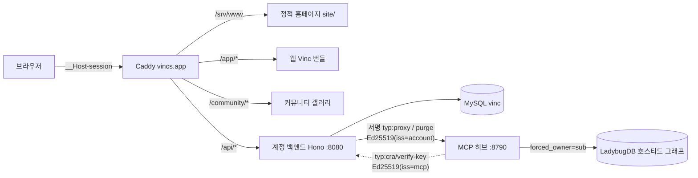

<!-- vinc-export
doc_id: vinc.c.web-vincs-app
title: vincs.app 웹 시스템 — 종합 문서 (as-built)
origin: Vinc-docs/vinc/WEB-vincs-app.md@5090690
chunks: 17
verified: true
content_hash: deca8d7af1ce8205b8ae003f01fd404cf201c8547a1bc9ed92b68aff1bf4cc9b
updated_at: 2026-08-01T16:20:15.717Z
-->

---
doc_id: vinc.c.web-vincs-app
layer: C
domain: web-vincs-app
title: vincs.app 웹 시스템 종합 (as-built) — 홈페이지 + 계정/이메일 + 웹 Vinc + 커뮤니티
status: draft
authority: SSoT (as-built)
version: v0.3
owner: vinc
last_updated: 2026-07-29
inherits_from: [vinc.b.architecture]
tags: [vinc, C, web, account, email, web-vinc, community, as-built, vincs-app]
---

# vincs.app 웹 시스템 — 종합 문서 (as-built)

> **범위:** `vincs.app` 공식 홈페이지 + 웹 계정/뉴스레터 백엔드 + **웹 Vinc**(브라우저 앱 빌드, `/app/`) + **커뮤니티 갤러리**(`/community/`) + **회원 커넥터 온보딩**(v0.2.0). 데스크톱 **네이티브** 앱(`Vinclums/Vinc`)의 오프라인 코어는 범위 밖이며, 그 네이티브 경계는 이 시스템에 참여하지 않는다(§1 불변식 주석 참조).
> **정본 도메인은 `vincs.io` 다.** 문서 제목과 `doc_id`(`vinc.c.web-vincs-app`)에 남은
> `vincs.app` 은 **역사적 이름**이다 — 레지스트리 두 곳이 이 id 로 참조하고 있어 그대로
> 둔다. 본문에서 `vincs.app` 이 나오면 그건 **발신 메일 도메인**을 가리키는 것뿐이다
> (§6.1). 웹 표면은 전부 `vincs.io`·`api.vincs.io`·`mcp.vincs.io` 다.
>
> **인프라 절 갱신 완료 (2026-07-30 실측).** 가비아 VM(`1.201.120.125`)+Caddy 는 전량
> 삭제됐고 **Azure**(SWA `vinc-site` + Linked Backend · Container Apps
> `vinc-account`/`vinc-hub` · MySQL Flexible)로 이관됐다. §1 표·§6.1 DNS·§10 을 그
> 기준으로 다시 썼다. 다만 **인프라 as-built 정본은 여전히
> `Vinc-docs/vinc/DEPLOYMENT.md`**(+ `AZURE-ARCHITECTURE.md`)이고, 여기 §10 은 "웹
> 표면이 어디에 얹혀 있는가"만 짚는다 — 절차·env·사고기록은 그쪽에만 있다.
> **애플리케이션 계약 서술**(§5 API·§7 프록시 체인·owner 강제 불변식·§8 커뮤니티)은
> 호스팅과 무관하게 유효하다.
>
> **상태:** 프로덕션 라이브. 계정 로그인·뉴스레터·이메일 전 구간 + 웹 Vinc 그래프 프록시 + 커뮤니티 공유 + 회원 커넥터/무료·Pro 티어 모두 동작. 아래 본문에 남은 다운로드 버전 `v0.3.1` 표기는 07-18 시점이고 **현행은 v0.6.7** 이다.
> **정본 스펙:** `Vinc/emails/ARCHITECTURE.md` (계정/이메일 보안 스펙, 이하 ARCH). 이 문서는 그 스펙을 **실제 구현·배포된 형태**로 기록한다.
> **계획서:** `Vinc-docs/plans/PLAN-web-account-email-backend.md`, `PLAN-newsletter-signin-ui.md`.
> **코드 권위:** 계정/홈페이지/커뮤니티 = `Vinclums/Vinc-homepage`(비공개, `account/`+`site/`). 웹 Vinc 프론트엔드(`app/src/api.ts` WEB 분기)·MCP 허브(`vinc_mcp/`) = `Vinclums/Vinc`(앱 리포). **Caddyfile(`deploy/Caddyfile`)은 더 이상 배포 정본이 아니다** — 적용될 서버가 없다.

---

## 1. 개요

`vincs.app`은 **같은 오리진**에서 서빙되는 정적/동적 표면 + 별도 서브도메인 `mcp.vincs.app`의 그래프 데이터 평면으로 구성된다.

| 구성 | 정체 | 기술 | 서빙 |
|---|---|---|---|
| **정적 홈페이지** (`site/`) | 마케팅·안내·계정/커넥터 UI. 빌드 단계 없음, 폴더가 곧 배포 산출물 | 순수 HTML/CSS/JS, 인라인, 자기완결 | SWA `vinc-site` |
| **계정 백엔드** (`account/`) | 로그인·뉴스레터·계정관리·커넥터·그래프 프록시·커뮤니티 API | Node 22 + Hono, MySQL, Resend | SWA Linked Backend `/api/*` → Container App `vinc-account` |
| **웹 Vinc** (`/app/`) | 데스크톱 앱의 **브라우저 빌드**. 계정 세션으로 인증, 그래프 read/write 완전 패리티 | 앱 리포 `app/` 프론트 WEB 분기 | SWA `/app/*` (CSP 없음 — §10.2) |
| **커뮤니티 갤러리** (`/community/`) | 회원 지식팩 공개 게시·다운로드 + 시각요약 | 정적 UI + `/api/community` | SWA `/community/*` |
| **MCP 허브** (`mcp.vincs.io`) | 호스티드 그래프 데이터 평면(계정 그래프 저장·질의) | 사이드카(컨테이너 내 `127.0.0.1:8787`) + MCP `8790` | Container App `vinc-hub` (SWA 미링크 — `/internal/*` 공개 도달) |

**핵심 불변식 (ARCH §1.1):**
- **B1** 데스크톱 **네이티브** 앱은 계정 API를 호출하지 않고, 세션을 만들지 않으며, 이메일/로그인/계정 UI를 렌더하지 않는다.
- **B2** 계정 백엔드와 MCP 허브는 서로의 DB를 읽지 않고 시크릿을 공유하지 않는다. 서비스간 신뢰는 **공개키 전용**(Ed25519 sign/verify — 각자 상대 공개키만 핀)이다.
- **B3** 명시적 업로드/옵트인 외 조용한 동기화는 없다(팩 업로드는 명시적, v0.3.0 sync 는 `selected_domains` 도메인별 옵트인).
- **B6** 패스워드리스 전용. 어디에도 password 필드·컬럼 없음.

> **네이티브 vs 웹 빌드 (불변식 경계 해설):** B1 은 네이티브 데스크톱 바이너리 경계에 대한 불변식이다 — ARCH 의 FORB '반입 금지'(과금/외부인증/학습=0)와 '외부 왕복 없음'도 그 경계에 걸린다. **웹 Vinc(`/app/`)는 같은 프론트엔드 코드의 별도 브라우저 빌드**로, 계정 세션쿠키로 인증해 `/api/graph` 프록시를 호출한다. 이는 B1 위반이 아니다(네이티브 바이너리가 아니라 브라우저 빌드가 계정과 대화하며, 여전히 B2 공개키 경계를 지킨다). 프론트는 `api.ts` 의 `WEB` 분기(`base=/api/graph`)로 두 빌드를 가른다.

이 분리를 위해 웹 시스템(계정/홈페이지/커뮤니티)은 데스크톱 앱 리포(`Vinc`)와 **물리적으로 분리된** 리포(`Vinc-homepage`)에 있다. 웹 Vinc 프론트엔드와 MCP 허브만 앱 리포에 함께 있다(같은 프론트 코드/그래프 엔진 재사용).



---

## 2. 리포 구조

```
Vinc-homepage/ (계정·홈페이지·커뮤니티)
  site/                      정적 홈페이지 (배포 → /srv/www)
    index.html               홈 (히어로 + 기능 + 로그인 + 뉴스레터 폼 + Web app/Community 링크)
    login/                   로그인 (매직링크 요청 UI)
    account/                 계정 관리 (로그인 필요)
      delete/                계정삭제 확인 인터스티셜
    auth/verify/             매직링크 랜딩 인터스티셜
    subscribe/confirm/       뉴스레터 확인 인터스티셜
    unsubscribe/             원클릭 해지 인터스티셜
    connect/                 커넥터 회원 승인 온보딩 (v0.2.0)
    community/               커뮤니티 갤러리 프론트
    privacy/                 개인정보 처리방침 (MCP 디렉토리 제출 요건)
    download/ guide/ release/ 안내 페이지 (다운로드 = v0.3.1)
  account/                   계정 백엔드 (배포 → 루프백 :8080)
    src/routes/              Hono API: auth·me·subscribe·account·keys·connect·
                             graph·community·internal·unsubscribe·webhooks
    src/services/            mailer·mcpProxy·mcpPurge·purgeCron
    src/lib/                 packSummary·edsign·tokens·cookies·audit …
    db/migrations/           001~008 (dbmate, forward-only)
    emails/                  트랜잭션 이메일 템플릿 (EN/KO × 5종)

Vinc/ (앱 리포 — 웹 Vinc 프론트 + MCP 허브 + 배포 정본)
  app/src/api.ts             WEB 분기(base=/api/graph) + ensureWebAuth 부팅 게이트
  vinc_mcp/http_server.py    MCP 허브: /internal/graph-owner·/internal/purge-owner
```

> ⚠ 이 절은 **가비아 VM 시절 구조**다(역사 서술). 그때는 `deploy/Caddyfile` 이 엣지
> 정본이었지만 VM·Caddy 와 함께 삭제됐고(2026-07-31 파일도 제거), 지금 엣지 규칙은
> `Vinc-homepage/site/staticwebapp.config.json`(SWA)에 있다. 도메인도 `vincs.app` 이
> 아니라 `vincs.io` 다. 현행 정본은 `Vinc-docs/vinc/DEPLOYMENT.md`.

`site/`·`/app/`·`/community/`·`account/`는 Caddy가 같은 오리진(`vincs.app`)으로 서빙한다. `api.vincs.app`은 **없다** — 같은 오리진이라야 `__Host-` 쿠키와 `SameSite=Lax`가 성립한다. 그래프 데이터 평면만 `mcp.vincs.app` 서브도메인이다.

---

## 3. 정적 홈페이지 (`site/`)

### 3.1 페이지·상태 목록

| 경로 | 역할 | 배선 |
|---|---|---|
| `/` | 홈: 히어로·기능·프라이버시. 헤더 **Sign in** + **Web app**(`/app/`)·**Community**(`/community/`) 링크, 푸터 앞 **뉴스레터 구독 폼** | `POST /api/subscribe` |
| `/login/` | 매직링크 요청. 이메일 입력 → check-inbox 전환 | `POST /api/auth/request` |
| `/account/` | 계정: 이메일·플랜·뉴스레터 토글·API 키·로그아웃·삭제. 미인증 시 `/login`으로 | `GET /api/me`, `/api/auth/logout`, `/api/account/newsletter`, `/api/account/keys*`, `/api/account/delete` |
| `/auth/verify/` | 매직링크 랜딩. 프래그먼트 토큰 소비 → 로그인 | `POST /api/auth/verify` |
| `/subscribe/confirm/` | 뉴스레터 더블옵트인 확인 | `POST /api/subscribe/confirm` |
| `/unsubscribe/` | 원클릭 해지(쿼리스트링 토큰) | `POST /api/unsubscribe?token=` |
| `/account/delete/` | 계정삭제 최종 확인 | `POST /api/account/delete/confirm` |
| `/connect/` | 커넥터 회원 승인 온보딩(CRA 디코드→동의→AA 발급) | `POST /api/connect/{describe,approve}` |
| `/connect-app/` | **데스크탑 앱 계정 연결**(디바이스 플로우, 2026-07-19) — 앱이 연 `#port&state` fragment → 로그인 게이트(/api/me, connect 와 동일 보관·복귀) → 승인 → 키 발급 → 루프백 `http://127.0.0.1:<port>/connect/callback`(사이드카 메일박스, state 단일사용)로 자동 전달. 실패 시 키 1회 노출 수동 폴백. 백엔드 신규 표면 0(키 발급 API 재사용), B1 유지(앱은 계정 API 무호출) | `GET /api/me` · `POST /api/account/keys` |
| `/community/` | 커뮤니티 갤러리(공개 목록·상세·다운로드, 게시=로그인) | `GET/POST /api/community/*` |
| `/app/` | 웹 Vinc(브라우저 앱 빌드) | `GET/POST /api/graph/*` (§7) |
| `/privacy/` | 개인정보 처리방침(MCP 디렉토리 제출 요건) | — |
| `/download/ /guide/ /release/` | 정적 안내 | — |

### 3.2 인터스티셜 보안 규칙 (ARCH §3.2)

이메일 링크가 도착하는 4개 페이지(`verify`·`subscribe/confirm`·`unsubscribe`·`account/delete`)는 엄격한 규칙을 따른다:

- **서드파티 애셋 0** — 외부 이미지·스크립트·폰트·스타일시트 전무. 완전 자기완결.
- **프래그먼트 토큰** — 로그인/확인/삭제 토큰은 URL `#fragment`로 전달(서버에 미전송·미로깅). JS가 읽은 즉시 `history.replaceState`로 제거. (해지 토큰만 RFC 8058 요건상 쿼리스트링)
- **프리페치 생존** — GET 로드 시 자동 POST 없음. 상태변경은 **명시적 클릭에만**. 스캐너 프리페치가 조용히 소비 못 함.
- **`no-referrer`** 메타 + 동일 오리진 fetch(`credentials:'include'`).

### 3.3 i18n·테마

모든 페이지는 EN/KO 토글(`data-i` 카피 덱) + 라이트/다크 테마 토글을 가진다. 기본 다크. `navigator.language`·`localStorage` 추종.

---

## 4. 디자인 시스템 (Ink & Paper)

따뜻한 종이 질감의 웜톤 팔레트. HSL 토큰 기반.

### 4.1 색

| 토큰 | 라이트 | 다크 |
|---|---|---|
| 배경 (background) | `#EFEAE1` (크림) | `#16130F` (웜 다크) |
| 카드 (card) | `#F7F2E9` | `#211E18` |
| 테두리 (border) | `#E0DACE` | `#39332B` |
| 본문 텍스트 (foreground) | `#14110B` | `#EAE5DD` |
| 보조 텍스트 (muted) | `#6B6252` | `#A39A8A` |
| primary (앱 UI 강조) | `#3F4A64` (슬레이트) | 동일 |

> **이메일 버튼은 primary(슬레이트블루)를 쓰지 않는다.** 웜 에스프레소 `#26221B`(다크모드 크림 `#E7E1D5`)를 사용한다.

### 4.2 로고 마크

**3개 점(작은→큰, 세로) + 아래 V자 스트로크.** SVG symbol `#vlogo` (viewBox 0 0 100 100):
- 원: `cy 13/28/50`, `r 3.8/6.4/13`
- V 경로: `M26 53 50 77 74 53`

정적 페이지는 인라인 SVG를 쓴다. **이메일은 Gmail이 인라인 SVG를 제거**하므로, 로고를 **CSS 원 3개**(border-radius)로 재현하고 "Vinc" 워드마크를 병기한다.

### 4.3 타이포

폰트 스택: `ui-sans-serif, system-ui, -apple-system, "Noto Sans KR", "Malgun Gothic", sans-serif`. em-dash(—) 미사용(구두점 규칙 D38).

---

## 5. 계정 백엔드 (`account/`, Node 22 + Hono)

### 5.1 API 엔드포인트 (전부 `https://vincs.app/api/*`, 내부용은 `/internal/*`)

| 메서드·경로 | 인증 | 설명 |
|---|---|---|
| `GET /api/health` | — | DB 연결 포함 헬스체크 |
| `POST /api/auth/request` | — | 매직링크 발급. 구문검증만, 유저 미생성, 15분 토큰 + `__Host-lc` 챌린지, uniform 200 |
| `POST /api/auth/verify` | — | 원자적 single-use consume, flow-binding 대조, find-or-create, 세션 발급 |
| `POST /api/auth/logout` | 세션·CSRF | 세션 row DELETE + 쿠키 clear |
| `GET /api/me` | 세션 | 화이트리스트 `{email, name?, plan, newsletter, created_at}` — `plan`은 007 컬럼 그대로 |
| `POST /api/subscribe` | — | 뉴스레터 구독. 허니팟, pending upsert, 24h 토큰, uniform 200 |
| `POST /api/subscribe/confirm` | — | 원자적 confirmed + welcome 발송 |
| `POST /api/account/newsletter` | 세션·CSRF | 뉴스레터 토글(ON=즉시 confirmed) |
| `GET·POST·DELETE /api/account/keys[/:id]` | 세션·CSRF | MCP 커넥터 API 키(`vinc_sk_…`) 목록/발급(원문 1회)/폐기(v0.2.0) |
| `POST /api/account/delete` | 세션·CSRF | 15분 삭제 토큰 발급 + 확인메일 |
| `POST /api/account/delete/confirm` | 토큰 | 단일 트랜잭션 하드삭제 + **호스티드 그래프 purge 캐스케이드**(§11.3) |
| `POST /api/connect/describe` | 세션·CSRF | CRA(MCP 서명) 검증 → 동의 화면용 **검증된** 대상 반환 |
| `POST /api/connect/approve` | 세션·CSRF | 승인 → AA(계정 서명, `sub`=publicId·`plan`) 발급 → MCP 복귀 URL |
| `GET /api/graph/*`, `POST /api/graph/*`, `GET /api/graph/jobs/:id` | 세션(쓰기 +CSRF) | 웹 Vinc 그래프 프록시(§7). owner 미수신 — 허브가 sub 로 강제 |
| `GET /api/community/packs[/:id[/download]]` | 공개 | 갤러리 목록·상세·`.vincpack` 다운로드 |
| `POST /api/community/publish`, `POST /api/community/packs/:id/unlist` | 세션·CSRF | 팩 게시(검증+요약)·본인 내리기 |
| `POST /api/unsubscribe?token=` | — | RFC 8058 원클릭 해지(멱등) |
| `POST /api/webhooks/resend` | Svix 서명 | bounce/complaint → suppression |
| `POST /internal/mcp/verify-key` | MCP Ed25519 어서션 | MCP `resolve_auth`가 `vinc_sk_…` 원문 키를 루프백 검증 → `{sub, plan}` |

> `/internal/*`은 `/api/*` 가드 밖 + Caddy **미프록시**(공개 미도달) + 루프백 바인딩이라 로컬에서만 닿고, 그 위에 MCP Ed25519 어서션(`iss=mcp·aud=account·≤120s`)을 필수화한다(심층방어). 계정만 `users`/`api_keys`를 본다(B2).

### 5.2 인증 플로우 (패스워드리스 매직링크)

1. **요청** — 이메일 입력 → `/api/auth/request`. 256-bit CSPRNG 토큰 생성, DB엔 `HMAC-SHA256(pepper, token)`만 저장. `__Host-lc` 챌린지 쿠키 세팅(same-browser 바인딩). 메일 발송. **존재 여부와 무관하게 동일 200**(enumeration 방지).
2. **랜딩** — 이메일 링크 `https://vincs.app/auth/verify#<token>` → 정적 인터스티셜이 토큰 읽고 명시적 클릭 대기.
3. **소비** — `/api/auth/verify`가 원자적 `UPDATE ... WHERE used_at IS NULL`(ROW_COUNT=1만 진행)로 single-use 보장. `__Host-lc` 일치 시 자동 진행, 불일치(크로스디바이스/포워드)면 **confirm-context** 화면. 첫 verify에서 유저 find-or-create.
4. **세션** — 불투명 서버측 세션(JWT 아님). `__Host-session`(HttpOnly·Secure·SameSite=Lax·no Domain), rolling 30d idle / 절대 90d. 로그인마다 회전. `__Host-csrf`(JS-readable) 더블서브밋.

### 5.3 세션·CSRF

- 세션 id 256-bit, DB엔 `HMAC(pepper, id)`만. 로그아웃·삭제 시 row DELETE로 즉시 무효화.
- 상태변경 인증 요청은 `X-CSRF-Token` 헤더 == `__Host-csrf` 쿠키(더블서브밋) + Origin/Referer allowlist + `Content-Type: application/json`.

### 5.4 데이터베이스 (관리형 MySQL 8.4)

데이터베이스 `vinc`, 계정 `vinc`(관리형 DB가 별도 유저 생성 불가). InnoDB, utf8mb4, `utf8mb4_0900_ai_ci`(이메일 대소문자 무시), `DATETIME(3)` UTC, 해시 전용 시크릿, forward-only 마이그레이션(dbmate).

| 테이블 | 마이그레이션 | 역할 |
|---|---|---|
| `users` | 001 (+ 007) | 첫 verify 시 생성. `public_id`(UUIDv7), `email`(ai_ci 유니크), **`plan` ENUM('free','pro')**(007, 기본 free) |
| `auth_tokens` | 002 | 매직링크/삭제 토큰. **email로 키잉**(users FK 없음), `token_hash`/`challenge_hash` BINARY(32), single-use |
| `sessions` | 003 | 서버측 세션. PK=`token_hash`, users FK CASCADE |
| `subscribers` | 004 | 뉴스레터 SSoT. `status` ENUM, `unsub_token` CHAR(43) 사용가능 저장 |
| `suppressions` | 005 | bounce/complaint 억제(웹훅이 채움), 발송 전 조회 |
| `api_keys` | 006 | MCP 커넥터 키(v0.2.0). `key_hash`=HMAC BINARY(32), `prefix`(표시용), users FK CASCADE |
| `community_packs` | 008 | 커뮤니티 게시물. `summary_json`(시각요약), `pack_json`(MEDIUMTEXT .vincpack), `status`(published/unlisted), users FK CASCADE |
| `schema_migrations` | — | dbmate 버전 추적 |

> 007 은 컬럼 추가(`users.plan`), 신규 테이블 아님. `plan`은 현재 **수동 pro 부여**(`UPDATE users SET plan='pro'`)이며, `/api/me`·MCP 티어 쿼터가 읽는 단일 소스. billing(ARCH §4.5 `subscriptions`)은 후속. 상세 스키마는 ARCH §4 및 `account/db/migrations/001~008`. 계획서의 `vinc_account` 스키마 + 최소권한 유저 2종은 관리형 DB 제약으로 미채택, 기존 `vinc` DB·계정 직접 사용. (참고: 메모리 `cloud-db-network`)

### 5.5 라이프사이클·운영 로직

- **만료 퍼지 크론** (트랙 5-4): 항상 켜진 서비스가 1시간 주기로 만료 토큰(24h grace)·세션·pending 구독자(7d) DELETE.
- **감사 로깅** (트랙 5-6): auth 이벤트(request/verify/logout/delete)를 `HMAC(pepper, email)` 해시 식별자 + 결과로만 기록. 토큰/PII 원문 미기록. 커넥터/키 이벤트(`connect.approve`, `account.apikey_*`, `mcp.verify_key`)도 requestId·이벤트만 기록.
- **레이트리밋**: `/auth/request` per-email 1/60s·5/h(무음)·per-IP 20/h(429). `/subscribe` per-email 3/h·per-IP 20/h. `/api/graph/*` per-회원 300/분. `/api/community/publish` per-회원 10/시. 인프로세스 토큰버킷 + auth_tokens 카운트.

---

## 6. 이메일 (Resend)

- **발신:** `Vinc <news@vincs.app>`. **transactional** 스트림.
- **템플릿:** `account/emails/{type}.{en|ko}.html`. 공홈 Ink&Paper 디자인, 외부 이미지·트래킹 픽셀 0, opaque 토큰 링크만.
- **발송 규칙:** `Idempotency-Key`, 3회 지수백오프, suppression 조회 후 발송. 실패해도 호출자엔 동일 200(enumeration 방지), 비동기 fire-and-forget.

| 트리거 | 타입 |
|---|---|
| 로그인 요청 | `magic_link` |
| **첫 계정 생성** (첫 verify) | `account_welcome` |
| 뉴스레터 구독 | `subscribe_confirm` |
| 구독 확인 완료 | `welcome` |
| 계정삭제 요청 | `account_delete_confirm` |

### 6.1 DNS — 두 도메인이 다른 곳에 산다 (실측 2026-07-30)

| 도메인 | 네임서버 | 무엇이 있나 |
|---|---|---|
| `vincs.io` | **Cloudflare** (celine/keaton) | 사이트·앱·API·MCP. 레코드 6개, 전부 `DNS only` |
| `vincs.app` | 가비아 | **Resend 발신 레코드 4종만.** A 레코드 없음 |

**발신 도메인과 링크 도메인이 갈려 있다(의도된 상태).** `MAIL_FROM=news@vincs.app`
(Resend DKIM/SPF 가 vincs.app 에 있어서, 옮기면 도메인 재인증 전까지 발송이 죽는다) ·
`SITE_BASE_URL=https://vincs.io`(본문 링크). 템플릿 안 리터럴 링크도 전부 vincs.io 다.

`vincs.app` 에 남은 Resend 4종 — Amazon SES ap-northeast-1:
- **DKIM** — TXT `resend._domainkey`
- **SPF** — `send` 서브도메인: MX `feedback-smtp.ap-northeast-1.amazonses.com` + TXT `v=spf1 include:amazonses.com ~all`
- **DMARC** — TXT `_dmarc`: **`v=DMARC1; p=reject;`** (로그인 메일 스푸핑 차단)

`feedback-smtp` MX 가 bounce/complaint 피드백 경로 → 웹훅 → suppression 을 살린다.

> **⚠ 이 4개를 지우면 로그인 메일이 죽는다.** `vincs.app` 의 A 레코드를 정리할 때
> 함께 지우기 쉬우니 주의할 것(2026-07-29 에 A 만 골라 지웠다).

`vincs.io` 존 6개 — apex A(SWA) · apex TXT(SWA 도메인 검증) · `api` CNAME ·
`mcp` CNAME · `asuid.api` TXT · `asuid.mcp` TXT. 뒤 넷은 Container Apps 커스텀
도메인이고 `asuid.*` 는 인증서 검증값이라 빠지면 갱신이 실패한다.
**Cloudflare 자동 스캔이 `mcp` CNAME 과 `asuid` TXT 둘을 놓쳤다** — 존 이관 시
자동 목록을 믿지 말고 원본과 대조할 것.

**전부 `DNS only`(회색 구름)여야 한다.** 프록시를 켜면 SWA·Container Apps 의 관리형
인증서 발급·갱신 경로가 막힌다. 부작용으로 Cloudflare 의 Content Signals(AI 정책)
설정도 효과가 없다 — 엣지에서 `robots.txt` 를 대신 서빙하는 방식이라 트래픽을 안
보면 적용 지점이 없다. 그래서 `robots.txt` 는 `site/` 에서 직접 낸다.

**문의 주소 = `support@vincs.io`** (2026-07-30 사이트 반영, 앵커 9개 — 홈 1 · `/mcp/` 1 ·
`/privacy/` 7). 이전엔 `support@vincs.app` 이었는데 **두 도메인 어디에도 MX 가 없어
수신 불가**였다 — 개인정보처리방침이 "질문·데이터 요청·기타 무엇이든" 이라며 안내하는
주소가 도착조차 하지 않았다.

`vincs.app` 을 쓰지 않는 이유: 그 존에는 **Resend 발신 레코드 4종만** 남아 있고 A 가
없다. 수신을 붙이려면 그 존에 MX 를 얹어야 하는데 발신용 `send` 서브도메인 MX 와
뒤섞여 **실수로 지우기 쉬운 구성**이 된다(그 4개를 지우면 로그인 메일이 죽는다).

수신은 **Cloudflare Email Routing** 으로 붙였다(2026-07-30 라이브). Routing 이
`vincs.io` 에 5개를 자동 추가한다 — MX 3개(`route{1,2,3}.mx.cloudflare.net`, 우선순위
23/43/6) · DKIM TXT(`cf2024-1._domainkey`) · SPF TXT(apex). **수동으로 넣지 말 것**
(우선순위·DKIM 값을 손으로 옮기다 틀린다). 기존 6개와는 충돌하지 않는다 — apex TXT 는
SWA 검증 토큰 하나뿐이고 TXT 는 같은 이름에 복수 공존하며, apex MX 는 원래 없었다(실측).

**설정 순서가 있다**(DNS 레코드만으로는 수신되지 않는다):
`Destination Addresses` 에 받을 메일함 추가 → **그 메일함에서 인증 링크 클릭** →
`Routing rules` 에서 `support@vincs.io` → 그 목적지. 인증 전에는 규칙에서 선택조차
안 된다. Destination 주소는 **Cloudflare 안에만 저장되고 공개되지 않는다** — 외부에
보이는 건 `support@vincs.io` 뿐이므로 개인 메일함을 목적지로 써도 노출 위험이 없고,
담당이 바뀌면 목적지만 갈면 된다(사이트 무수정).

**검증은 메일을 보내지 않고 한다** — SMTP `RCPT TO` 까지만 물어보고 `DATA` 없이 끊는다:
```
RCPT TO support@vincs.io        -> 250 2.1.0 Ok
RCPT TO nosuchaddr9x7@vincs.io  -> 550 5.1.1 Address does not exist
```
**둘 다 봐야 한다.** 250 만 확인하면 catch-all 이 켜져 전부 받는 상태(스팸 자석)를
정상으로 오독한다. 실측 시 두 MX 호스트(route1·route3)에 각각 물었다.

> ⚠ **SPF 병합 함정 — 나중에 반드시 걸린다.** Routing 이 넣는 apex SPF 는
> `v=spf1 include:_spf.mx.cloudflare.net ~all` 이고 **여기에 Resend(amazonses)가 없다.**
> 지금은 무해하다(발신이 `news@vincs.app` 이고 그 도메인에 별도 SPF 가 있다). 그러나
> `MAIL_FROM` 을 `vincs.io` 로 옮기는 순간 이 레코드가 **발송을 죽인다.** 그때는 한 줄로
> 합쳐야 한다:
> ```
> v=spf1 include:_spf.mx.cloudflare.net include:amazonses.com ~all
> ```
> **두 번째 `v=spf1` TXT 를 따로 만들면 안 된다** — SPF 는 이름당 하나만 허용되고 두 개면
> `PermError` 로 전부 실패한다. "추가하면 되겠지"가 정확히 틀리는 지점이다.

---

## 7. 웹 Vinc (`vincs.app/app/`)

데스크톱 앱과 **같은 프론트엔드 코드의 브라우저 빌드**. 로컬 사이드카(`:8787`) 대신 계정 세션으로 인증해 호스티드 그래프를 read/write 한다. `app/src/api.ts` 의 `WEB` 상수 분기가 데이터 base 를 `/api/graph` 로 돌린다.

### 7.1 인증·부팅 게이트

- **부팅** — `ensureWebAuth()`(api.ts) 가 `main.ts` 부팅 시 게이트로 돈다. `__Host-csrf`(JS-readable) 동기 확인 또는 `GET /api/me` 로 세션을 검증하고, 미인증이면 즉시 `/login` 으로 보낸다.
- **쿠키** — `__Host-session`(read/write 자동 첨부, `credentials:'include'`), 쓰기엔 `__Host-csrf` 더블서브밋.

### 7.2 프록시 체인 (owner 강제 = B2 불변식)

```
프론트 api.ts(WEB, base=/api/graph)
  → 계정 graph.ts  requireAuth(+쓰기 requireCsrf), owner **미수신**
  → services/mcpProxy.ts  계정 개인키로 Ed25519 서명(typ:"proxy", iss:account, aud:mcp, sub=세션 publicId, op, ≤120s)
  → 허브 POST /internal/graph-owner (mcp.vincs.app 루프백 8790)
  → http_server.py 어서션 검증 → forced_owner=sub → tools 가 args.owner 를 덮어씀
  → 로컬 그래프 엔진(LadybugDB — Kùzu 계보)
```

- **owner 는 서명된 `sub` 에서만** 온다 — 프론트/계정 어느 층도 요청 바디로 owner 를 받지 않는다. 그래서 한 회원 세션으로 남의 그래프에 못 닿는다(교차테넌트 봉쇄, SEC-3 과 정합).
- **공개키 전용(B2)** — 계정은 서명, MCP 는 **계정 공개키만** 핀해 검증. 시크릿·DB 공유 0. `mcpProxy`/`mcpPurge`/`connect` 가 같은 키(`ACCOUNT_ED25519_SEED`)를 쓰며, 미설정이면 웹 그래프 표면만 `disabled`(현행 사이트 동작 유지, 점진 배포).

### 7.3 완전 쓰기 패리티

허브 op 화이트리스트로 데스크톱 앱과 동일한 read/write 를 노출한다.

- **읽기(GET)** — `atlas·graph·recall·search·coupling·suggest-ties·decide·domains·promote-candidates·learner·share` + `jobs/:id`(비동기 적재 폴링).
- **쓰기(POST, +CSRF)** — `pin·tag·touch·activate·delete·merge-nodes·ingest-fragment·ingest-pack`.
- **표면 밖** — `themes/types`(서버 전역 vocab)·`sync`·`backup`(로컬 설정)은 웹 프록시가 노출하지 않는다.

---

## 8. 커뮤니티 공유 (`vincs.app/community/`)

회원이 지식팩을 **공개 갤러리**에 게시하고, 누구나 요약을 보고 다운로드해 자기 Vinc 에 import 한다. 팩 포맷은 Share Pack(=MCP fragment 동형 `{nodes,edges}`, `vinc.c.sharepack`)이며, 웹 Packs 표면의 동의 게이트 게시 시트(`community.publish`)가 이 포맷을 페이로드로 쓴다.

### 8.1 게시·조회 (`/api/community`, `repos/communityPacks.ts`)

- **게시(POST `/publish`)** — 세션+CSRF+per-회원 rate-limit(10/시). `lib/packSummary.ts` 의 `validatePack`(팩 검증) → `summarizePack`(시각요약 계산) → 저장. 크기 상한 **2MB**(직렬화 바이트), 요약 노드 상한 `MAX_NODES=5000`. `user_id` FK 로 게시자 책임성 부착.
- **시각요약(`summary_json`)** — 도메인 분포·노드/엣지 counts·교차도메인 %·top 태그·엣지 타입 분포. 갤러리가 그대로 렌더.
- **조회/다운로드(GET, 공개)** — `/packs`(목록), `/packs/:id`(상세), `/packs/:id/download`(`.vincpack` 첨부 + 다운로드수 증가).
- **내리기(POST `/packs/:id/unlist`)** — 게시자 본인만. `status=unlisted`(갤러리 미노출, 하드삭제 아님). 계정 삭제 시 `community_packs`는 CASCADE 로 함께 제거(purge 정합).
- **모더레이션** — 즉시공개 + 경량 안전(크기/포맷/제목·설명 길이 검증).

### 8.2 ⚠ 공식 스타터팩 시딩 — 마이그레이션이 아니라 **수동 단계**다

마이그레이션 `010_official_packs.sql` 은 **스키마만** 바꾼다(`user_id` NULL 허용 +
`is_official`). 실제 행은 `account/scripts/seed-official-packs.ts` 가 넣는다 —
**운영자 수동 실행**이다. 그래서 DB 를 새로 만들면 마이그레이션은 다 돌아도 **공식팩만
조용히 사라진다.** Azure 이관에서 실제로 그렇게 됐고(2026-07-30 `community_packs` 0행
실측), 갤러리가 빈 채로 서빙되고 있었다.

**시딩 전 ZIP→JSON 변환이 필요하다.** D55 이후 `.vincpack` 은 zip 컨테이너인데
(`Vinc/api/packfile.py`), 시딩 스크립트와 커뮤니티 저장 경로는 **JSON 전용**이다 —
`pack_json` 이 `MEDIUMTEXT` 이고 다운로드가 `Content-Type: application/json` 이다.
이건 버그가 아니라 packfile 의 명시적 계약이다("**읽기는 두 형식 모두** 받고 **쓰기만**
zip"). 따라서 갤러리에는 JSON 형식으로 넣는 것이 정상이고, 앱은 하위호환으로 읽는다.

절차:
```python
# ZIP .vincpack -> JSON .vincpack (documents 포함 그대로)
from api import packfile                       # Vinc 리포
pack = packfile.from_bytes(open(zip_path,'rb').read())
json.dump(pack, out, ensure_ascii=False)       # 이 파일을 매니페스트가 가리키게
```
```bash
# DB env 주입 후 (SERVER_PEPPER/SESSION_SECRET/CSRF_SECRET 는 시딩에 안 쓰이므로
# 실제 시크릿 대신 더미 32B base64 로 통과시킨다 — env.ts 가 import 시점에 검증한다)
npx tsx scripts/seed-official-packs.ts <매니페스트.json>
```
제목 기준 멱등 upsert 라 재실행이 안전하다. 실측 크기(문서 포함 JSON): physics 1.57MB ·
art 0.91MB · math 0.79MB · economics 0.63MB — **전부 2MB 상한 아래**지만 여유가 크지
않으니 팩이 커지면 상한을 먼저 확인할 것.

> ⚠ **`starter-packs/` 는 어떤 리포에도 속하지 않는다**(워크스페이스 루트, 로컬 전용).
> 공식팩의 원천(`work/` 원고 · `tools/` 파이프라인 · `.vincpack` 산출물)이 개발 기기
> 하나에만 있다. 이 기기를 잃으면 공식팩을 **재생성할 수 없다** — 갤러리의 행은 DB 에
> 있으니 서비스는 살지만, 팩을 고치거나 다시 만들 길이 사라진다. 버전 관리 편입은 미결.

## 9. 회원 커넥터 온보딩 · 무료/Pro 티어 (v0.2.0)

"관리키 복붙" 단일 소유자 모델을 끝내고, 회원별 인증·엔타이틀먼트로 전환한 층.

- **API 키(`/api/account/keys`, `keys.ts`)** — 회원이 `vinc_sk_<43>` 키를 발급(원문은 응답 1회만, DB엔 `HMAC(pepper)` 해시만). 목록·폐기(멱등, 소유자 한정). `MAX_ACTIVE_KEYS` 상한.
- **커넥터 승인(`/api/connect/{describe,approve}`, `connect.ts`)** — MCP 가 보낸 **CRA**(커넥트 요청 어서션, MCP 서명)를 계정이 검증해 동의 대상을 **검증된 값으로** 보여주고(`describe` — 위조 `client_name` 방어), 회원이 승인하면 **AA**(계정 서명, `sub`=publicId·`plan`, 2분·단일소비)를 발급해 MCP 복귀 URL 로 돌려보낸다. 서로 공개키만 핀(B2).
- **티어(`users.plan`)** — `free`/`pro` ENUM. `/api/me`·MCP 쿼터가 읽는 단일 소스. 현재 수동 pro 부여, billing 후속.
- **MCP 라우팅** — MCP 도구는 `target(local|remote)` 로 로컬 스토어/호스티드 계정 그래프를 가른다(`vinc_mcp/remote.py`, `VINC_REMOTE_MCP_TOKEN`). 원격 경로에서 `resolve_auth` 가 `vinc_sk_…` 를 `/internal/mcp/verify-key` 루프백으로 확인한다.

---

## 10. 배포·인프라 (Azure, 2026-07-30 실측)

**정본은 이 문서가 아니다** — `Vinc-docs/vinc/DEPLOYMENT.md`(+ `AZURE-ARCHITECTURE.md`)가
인프라 as-built 정본이다. 여기서는 **웹 표면이 어디에 얹혀 있는지**만 짚고, 절차·
사고기록·env 목록은 옮겨 적지 않는다(두 벌이 되면 반드시 어긋난다).

가비아 VM(`1.201.120.125`)·관리형 MySQL·Caddy·systemd 유닛은 **전부 삭제됐다.**
SSH·tar-over-ssh 배포 경로는 존재하지 않는다.

| 웹 표면 | 지금 어디에 |
|---|---|
| 정적 홈페이지 · 웹 Vinc `/app/` · 커뮤니티 `/community/` | Static Web App `vinc-site` (Free) |
| 계정 백엔드 `/api/*` | Container App `vinc-account` — SWA **Linked Backend** 로 결합 |
| MCP 허브 `mcp.vincs.io` | Container App `vinc-hub` + Azure Files 볼륨(그래프 영속) |
| DB | Azure Database for MySQL Flexible Server `vinc-mysql01` |

**배포는 전부 GitHub Actions(OIDC)다.** `site-deploy.yml` · `account-deploy.yml` ·
`hub-deploy.yml` 셋이 push 경로 필터로 돈다. 손으로 올리는 경로는 없다.
`site-deploy` 는 **두 리포를 교차 체크아웃**한다 — `site/` 는 Vinc-homepage,
`/app/` 번들은 `Vinclums/Vinc` 의 `app/` 을 `VITE_BASE=/app/` 로 빌드해 합친다.

### 10.1 Linked Backend 가 만드는 세 가지 결과

`/api/*` 가 same-origin 으로 도달하는 것은 SWA 의 Linked Backend 덕이다. 여기서
따라오는 사실 셋을 모르면 사고가 난다:

- ⚠ **본문 없는 POST 는 `Content-Type` 헤더를 잃는다**(2026-07-30 실측). 그러면
  `firstPartyGuard` 가 `"Content-Type must be application/json"` 400 으로 막는다.
  Caddy 시절엔 통과하던 **Azure 이관 회귀**다. 갈라 확인한 결과:
  ```
  POST /api/auth/logout  (본문 없음)  -> 400 Content-Type must be application/json
  POST /api/auth/logout  -d '{}'      -> 401 not_authenticated   (가드 통과)
  ```
  **상태변경 POST 에는 반드시 `body: "{}"` 라도 실을 것.** 서버 가드를 푸는 쪽으로
  고치면 안 된다 — 그 가드가 CSRF 심층방어다. 이 버그로 `/api/auth/logout` 과
  `/api/account/delete` 가 죽어 있었고, 로그아웃은 프론트가 `.finally()` 로 실패해도
  `/login/` 으로 이동해 **세션이 살아 있으니 다시 `/account/` 로 튕기는** 루프가 돼
  "로그아웃이 안 먹는다"로 보였다. 새 POST 를 추가할 때 body 유무를 점검할 것.

- **계정 컨테이너의 직접 FQDN 은 401 이다.** Linked Backend 가 그 앱에 EasyAuth 를
  자동으로 켜기 때문이다. 헬스체크를 컨테이너 FQDN 으로 하면 항상 실패한다 —
  **반드시 SWA 호스트네임(`vincs.io/api/...`) 경유**로 확인할 것.
- **허브는 SWA 에 링크돼 있지 않다.** 그래서 `mcp.vincs.io/internal/*` 가 공개
  도달 가능하고, **Ed25519 서명만이 유일한 관문**이다. Caddy 시절의
  `respond 404` 차단층은 없어졌다 — 이 사실이 §7 의 owner 강제 불변식을 더 중요하게
  만든다(엣지가 대신 막아주지 않는다).

### 10.2 캐시·보안헤더 — Caddy 시절 대비 회귀 2건 (실측 2026-07-30)

`staticwebapp.config.json` 이 **없다.** 그래서 전부 SWA 기본값이고, Caddy 가 주던
것 중 둘이 사라졌다.

`curl -I https://vincs.io/` 실측:

| 헤더 | 지금 | Caddy 시절 |
|---|---|---|
| `Strict-Transport-Security` | `max-age=10886400; includeSubDomains; preload` | 1y (preload 보류) |
| `X-Content-Type-Options` | `nosniff` | 동일 |
| `Referrer-Policy` | `same-origin` | `no-referrer`(더 엄격했다) |
| **`Content-Security-Policy`** | **없음** | `default-src 'self'` 외 |
| **`X-Frame-Options`** | **없음** | `DENY` |

CSP 부재가 특히 아프다 — 사이트는 인라인 스크립트·스타일로 자기완결이라 CSP 를
되살리기 쉬운 구조인데(`'self' 'unsafe-inline'` 로 이미 운영해 봤다) 지금은 아무
제약이 없다. `frame-ancestors 'none'`(=`X-Frame-Options: DENY`)도 함께 빠져
클릭재킹 방어가 0 이다.

**캐시도 회귀다.** 해시 애셋(`/app/assets/index-*.js`, 1.7MB)이
`Cache-Control: public, must-revalidate, max-age=30` 을 받는다. 파일명에 해시가
박혀 있어 **1년 immutable 이어야 정상**인데 30초마다 재검증한다(ETag 304 라
전송량은 아니지만 왕복이 매번 생긴다). Caddy 는 `max-age=31536000, immutable` 을
줬다.

**회복 완료(2026-07-30)** — `Vinc-homepage/site/staticwebapp.config.json` 신설.
CSP 를 새로 창작하지 않고 **Caddy 시절 실제로 돌던 값을 그대로 옮겼다**
(당시 `Vinc/deploy/Caddyfile` 38~44행 — 그 파일은 2026-07-31 삭제됐고 값의 출처로만
남는다. 원문이 필요하면 git 이력에서 꺼낼 것): `default-src 'self'; style-src 'self'
'unsafe-inline'; script-src 'self' 'unsafe-inline'; frame-ancestors 'none'`.
사이트가 인라인 스타일·스크립트로 자기완결이고 외부 오리진 참조는 `github.com`
**링크(href)뿐**이라 CSP 대상이 아니다(실측).

⚠ 캐시 규칙에서 놓치기 쉬운 지점: `/assets/gnb.js`·`tokens.css`·`site.css` 는
**해시가 없는 공유 단일소스**라 `no-cache` 여야 한다. `/assets/*` 를 일괄
immutable 로 걸면 상단 내비가 1년간 고정된다. SWA 는 라우트가 **선착순**이라 이 셋을
`/assets/*` 보다 먼저 둔다.

`/api/*` 에는 라우트를 걸지 않았다 — Linked Backend 경로에 route 항목을 얹으면
프록시 라우팅에 간섭할 위험이 있고, 그게 깨지면 로그인부터 웹앱 전체가 죽는다.
`no-store` 하나 얻으려 감당할 위험이 아니다.

`robots.txt`·`sitemap.xml` 은 `site/` 에서 직접 낸다. Cloudflare 는 DNS only 라
엣지에서 robots 를 대신 서빙하지 못하므로 Content Signals 설정은 효과가 없다(§6.1).

### 10.3 허브만의 제약 — 임베디드 DB 단일 writer

허브는 LadybugDB 파일에 **배타 락**을 건다. 두 리비전이 같은 Azure Files 볼륨을
물면 새 리비전이 스토어를 못 열고 `Failed` 로 남는데, **구 리비전이 계속 서빙하므로
배포가 안 됐는데 서비스는 정상**으로 보인다. `hub-deploy.yml` 이 「이미지 갱신 →
구 리비전 deactivate → 신 리비전 Running 확인」 순서를 강제한다. 손으로 만질 때도
같은 순서를 지킬 것. 상세: DEPLOYMENT §4.3.

---

## 11. 전체 사용자 플로우

### 11.1 로그인 (E2E)
```
vincs.app → [Sign in] → /login → 이메일 입력
  → POST /api/auth/request → [magic_link 메일]
  → 링크 클릭 → /auth/verify#token → POST /api/auth/verify
  → (첫 계정이면 account_welcome 발송) → 세션 → /account
```

### 11.2 뉴스레터 (더블 옵트인)
```
홈 구독 폼(+허니팟) → POST /api/subscribe → [subscribe_confirm 메일]
  → /subscribe/confirm#token → POST /api/subscribe/confirm
  → confirmed + [welcome 메일]
해지: 메일의 List-Unsubscribe / /unsubscribe?token= → POST /api/unsubscribe (멱등)
```

### 11.3 계정 삭제 (2단계 비가역 + 그래프 purge 캐스케이드)
```
/account → Delete → POST /api/account/delete → [account_delete_confirm 메일]
  → /account/delete#token → POST /api/account/delete/confirm
  → consume(원자적) → **호스티드 그래프 purge 먼저 시도**(mcpPurge → 서명 /internal/purge-owner)
       ├ 미설정: skip(현행)
       ├ 성공: 라벨별 삭제 건수 확인
       └ 실패: fail-closed → 503, 계정 미삭제(재시도)  ← "지웠다"가 거짓이 되지 않게
  → purgeResendIdentity(provider 정리)
  → 단일 트랜잭션 하드삭제(auth_tokens/users[CASCADE sessions·api_keys·community_packs]/subscribers)
  → 세션 clear. 로컬 vault 미접촉.
```
> purge 는 `owner=user:{public_id}` 를 서명(`typ:"purge"`, iss=account) 으로만 지정하며, users 행이 사라지기 **전에** public_id 를 확보해 보낸다. B2 대칭(connect 와 방향만 반대).

### 11.4 웹 Vinc / 커뮤니티 (E2E)
```
로그인 세션 → /app/ → ensureWebAuth 게이트(OK) → 그래프 read/write(/api/graph/* → 허브)
공유: /app Packs → 게시 시트(동의) → POST /api/community/publish → /community 갤러리
다운로드: /community → 팩 상세(시각요약) → /packs/:id/download(.vincpack) → import
```

---

## 12. 보안 요약

- **격리:** 계정/홈페이지/커뮤니티는 네이티브 앱과 물리 리포 분리(B1/B3), 전용 OS 유저, DB 계정 사설망 잠금 + SSL. 서비스간은 공개키 전용(B2).
- **패스워드리스:** 매직링크만. password 필드/컬럼 0.
- **토큰:** 256-bit CSPRNG, DB엔 HMAC(pepper) 해시만, single-use 원자적 consume, 15분 TTL. API 키(`vinc_sk_`)도 해시 저장.
- **쿠키:** `__Host-` 프리픽스 3종(session·lc·csrf), HttpOnly/Secure/SameSite=Lax.
- **CSRF:** SameSite + Origin allowlist + 더블서브밋.
- **테넌트 격리(SEC-1/2/3):** 읽기·쓰기 전 경로 owner-스코프. 웹/커넥터 owner 는 서명된 `sub` 로만 강제(요청 바디 owner 미수신), MCP `forced_owner` 가 클라이언트 owner 덮어씀. 실엔진 2-owner 테스트 검증.
- **계정 삭제 캐스케이드:** 호스티드 그래프 purge 를 하드삭제 전에 fail-closed 로 시도(§11.3).
- **enumeration 방지:** 항상 uniform 200, 비동기 발송, 존재 분기 없음, 허니팟.
- **피싱:** 15분 single-use + same-browser flow-binding + confirm-context, DMARC `p=reject`.
- **인터스티셜:** 서드파티 0, 프래그먼트 토큰, 프리페치 생존.
- **엣지:** `/internal/*` 공개 404(루프백 전용) + 강한 CSP/HSTS/보안헤더 + no-store API 캐시(§10.3).
- **로깅:** 해시 식별자만, 토큰/시크릿/PII 원문 미기록.

---

## 13. 미완·차기

- **이메일 로고 디자인 확산** — `magic_link`·`account_welcome`엔 CSS 점 마크 적용됨. 나머지(`subscribe_confirm`·`welcome`·`account_delete_confirm`)는 구 텍스트 워드마크 → 확산 예정.
- **인터스티셜 디자인 마감** — 기능 완성, 비주얼 폴리시 대기.
- **트랙 6** — CI 가드(앱-격리 grep·금칙어 린트), 배포 시 격리 검증 자동화.
- **Billing(구독)** — `users.plan` 은 현재 **수동** pro 부여. `subscriptions`(ARCH §4.5) + Resend/결제 웹훅 → `plan` 캐시 투영은 후속(forward-only 추가). ※ 무료/Pro **티어 자체**(007)와 커뮤니티 공유(008)는 이미 라이브 — 스펙만 보존이 아니다.

---

## 부록 — 관련 문서·메모리

- 정본 스펙: `Vinc/emails/ARCHITECTURE.md`
- 배포 정본: `Vinc-docs/vinc/DEPLOYMENT.md`(구 `Vinc/deploy/Caddyfile`·`OPERATOR-RUNBOOK.md`
  는 가비아 VM 과 함께 무효가 되어 2026-07-31 삭제 — git 이력에만 남는다)
- 원격 프로파일: `vinc.d.remote-profile`(D36), `vinc.c.p5-remote-rollout`
- 공유 팩: `vinc.c.sharepack`(D19), 데이터플레인 `vinc.c.dataplane`
- 계획서: `Vinc-docs/plans/PLAN-web-account-email-backend.md`, `PLAN-newsletter-signin-ui.md`
- 메모리: `vinc-homepage-repo`(리포·배포), `cloud-db-network`(DB), `vinc-live-server`(인프라), `vinc-web-vinc`(웹 Vinc), `vinc-community-sharing`(커뮤니티), `vinc-account-delete-purge`(purge), `vinc-sec3-write-tenancy`(SEC-3), `vinc-v020-plan`(커넥터/티어)
