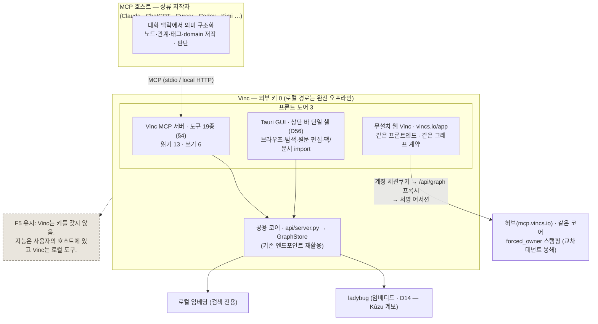
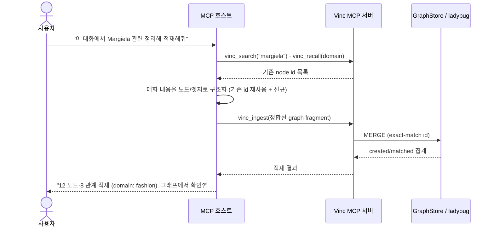

<!-- vinc-export
doc_id: vinc.mcp
title: Vinc MCP 인터페이스 · 도구 계약
origin: Vinc-docs/vinc/MCP-INTERFACE.md@5090690
chunks: 9
verified: true
content_hash: 662fc81c2887a2a3e1296e1562979383d4d3519999757d3a1ab7e0e483075ae2
updated_at: 2026-08-01T16:20:11.817Z
-->

---
doc_id: vinc.mcp
layer: C
domain: mcp-interface
title: Vinc MCP 인터페이스 · 도구 계약 (DEC D11)
status: draft
authority: SSoT
version: v0.4
owner: vinc
last_updated: 2026-07-29
inherits_from: [vinc.arch, vinc.a.terms]
tags: [vinc, mcp, contract, ingest, dec, d11]
---

# Vinc MCP 인터페이스 · 도구 계약

> **DEC D11 — 채택.** Vinc는 데스크톱 GUI 외에 **MCP 서버**를 두 번째 프론트 도어로 둔다.
> 상류 저작(원문 → 의미 구조화·관계 추론)은 사용자의 **MCP 호스트**가 대화 맥락에서
> 수행하고, Vinc는 기존 엔드포인트(`/ingest /search /graph /recall /decide`)를 **MCP tool로
> 얇게 래핑**해 노출한다. 지능은 Vinc 밖에 있으므로 **F5(오프라인·외부 키 0)** 를 깨지 않는다.
>
> **호스트 중립(2026-07-25 명시).** 본 계약에 특정 벤더 조항은 없다 — 호스트는 MCP를
> 말하는 어떤 어시스턴트여도 된다(§9). 이전 판이 "Claude"라고 쓴 자리는 전부 "MCP 호스트"를
> 뜻했으며, 구현도 처음부터 그러했다(`vinc_mcp/rpc.py`·`tools.py`에 벤더 코드 0).

## 1. 배경 — 왜 MCP인가 (아키텍처 긴장 해소)
원본 시스템은 2층이었다: ① 의미 구조화(LLM 저작, 원본 core) → ② 결정론적 적재(엔진). Vinc는
②만 흡수해 단독으로는 "원하는 느낌의 구조화"가 불가했다([[vinc.arch]]). MCP는 이 긴장을 **우회**한다.
- 저작 LLM을 Vinc 안에 넣으면 F5(오프라인) 위반 → **넣지 않는다.**
- 대신 사용자가 이미 쓰는 어시스턴트가 저작자 역할을 맡고, Vinc는 그 호스트가 부르는 **로컬 도구**가 된다.
- "의미는 상류가 부여, Vinc는 옮긴다"는 원래 철학이 그대로 유지된다(달라진 건 배치 저작 → 실시간 대화형 저작).
- 저작자를 특정 벤더에 묶지 않는 것이 이 배치의 **귀결**이다: 지능이 밖에 있다면, 어느 밖이든 상관없어야 한다.

## 2. 아키텍처 — 하나의 코어, 세 개의 프론트 도어



세 번째 도어(무설치 웹 Vinc)는 **같은 프론트엔드 소스**(`Vinc/app/`, `VITE_BASE` 만 다름)를
빌드해 서빙하고 **같은 그래프 계약**을 쓴다 — 다른 것은 그 계약이 닿는 곳뿐이다(로컬 사이드카가
아니라 계정 세션 뒤의 호스티드 그래프). 배포 표면·경로의 현행은 `DEPLOYMENT.md` 가 정본이다.
MCP 도어도 마찬가지로 **로컬만이 아니다**: 모든 도구가 `target: local|remote` 를 받아
원격(`mcp.vincs.io`)을 고를 수 있고, 원격은 키가 owner 를 고정한다(`vinc_mcp/tools.py` `_TARGET_PROP`).

## 3. 정합성 규약 — read-before-write (DEC D11-a: 하이브리드 (c))
MCP로 오면 호스트는 기존 그래프 상태를 모른 채 노드를 만든다 → 중복 노드 위험. 원본 연결은 항상
`id`(doc/concept/stem) **문자열 정확 매칭**이었다. 이를 계약에 명시한다.

**Push 표준 흐름:**


**책임 분담(하이브리드 c):**
- **호스트 책임** — `vinc_ingest` 전에 `vinc_search`/`vinc_recall`로 기존 id를 조회하고, 있으면 그 id를 재사용해 fragment를 구성한다. (규약)
- **Vinc(서버) 백스톱** — 들어온 노드를 `id` **정확 매칭**으로만 MERGE(존재 시 갱신, 없으면 생성). **유사도·의미 판단은 하지 않는다** — 원본 exact-match 동작 그대로이므로 순수 엔진 원칙 이탈 아님. 정확-id 충돌만 흡수(안전망).

**규약 준수는 호스트마다 다르다 — 그래서 사후 정리 경로가 계약의 일부다.** 규약을
지키지 않는(또는 덜 지키는) 호스트에서는 `concept:margiela`와 `concept:maison-margiela`
같은 중복이 쌓인다. 서버는 이를 **막지 않는다**(막으려면 의미 판단이 필요하고 그건
순수 엔진 원칙 위반). 대신 되돌린다: `vinc_merge_candidates`(조회)로 후보를 뽑고
`vinc_merge_nodes`(concept fold)로 접는다. 즉 **호스트 다변화의 비용은 "동작 불가"가
아니라 "머지 후처리 증가"** 이며, 이 도구 2종의 존재 이유가 여기 있다.
지시 채널은 시스템 프롬프트가 아니라 **도구 description** 이다(약한 호스트일수록
그것이 유일한 통로) — `vinc_mcp/tools.py`의 `nodes` 설명이 read-before-write를 명시한다.

## 4. 도구 계약 — 19종 (읽기 13 · 쓰기 6)
정본은 `vinc_mcp/tools.py` 의 `TOOLS` 리스트다. 기본 경로는 로컬 사이드카
(`127.0.0.1` + 세션 토큰)이고 그 경로는 오프라인에서 동작한다. 모든 도구가 공통으로
`target: local|remote` 를 추가로 받으며(`_TARGET_PROP`), `remote` 는 계정 그래프
(`mcp.vincs.io`)를 향하고 owner 는 키가 고정한다 — 계약(입출력)은 양쪽이 동일하다.

**읽기 도구 13 (부작용 없음):**

| tool | 입력 | 출력 | 매핑 |
|---|---|---|---|
| `vinc_search` | `{ query, limit?=20, owner? }` | `{ rows:[…청크 매치], node_hits:[{id,title,kind,domain,matched_in}], error? }` | `GET /search?query&top_k&owner` (BM25+벡터 RRF, `node_hits` 는 제목 스캔으로 항상 채움) |
| `vinc_recall` | `{ owner?, domain?, tags?[], limit?=50 }` | 최근 episode 목록 | `GET /recall` |
| `vinc_graph` | `{ seed_id, depth?=2(1–4), owner? }` | `{ nodes:[…], edges:[…] }` (seed+depth ego 순회) | `GET /graph?seed&depth&owner` |
| `vinc_decide` | `{ topic, depth?=2, owner? }` | `{ nodes:[…], edges:[…], conflicts:[…] }` (결정 지원, 결정론) | `GET /decide` |
| `vinc_domains` | `{ owner? }` | 데이터에서 발견된 domain 목록(**개방 집합** — 고정 목록 아님) | `GET /domains` |
| `vinc_conventions` | `{ owner?, lang? }` | `{ text, source:"doc"\|"default", doc_id, missing? }` — 쓰기 관례(GRAPH.md). 문서가 없으면 도메인·재가 어휘를 채운 기본본 | `GET /conventions` ([[vinc.c.graph-md]] §6.2) |
| `vinc_suggest_ties` | `{ node, limit?=5, owner? }` | 태그·domain 근접 기반 링크 후보 | `GET /suggest-ties` |
| `vinc_neighbors` | `{ node, limit?=50, owner? }` | `{ neighbors:[{rel,id,title,domain}], by_rel:{type:count}, count }` (1-hop 관측, E-G5) | `GET /neighbors` |
| `vinc_path` | `{ a, b, max_depth?=6, owner? }` | `{ found, length, paths:[{ids,titles,length}], count }` (동률 포함 all-shortest, E-G7) | `GET /path` |
| `vinc_merge_candidates` | `{ limit?=20, min_score?=0.6, owner? }` | `{ candidates:[{a_id,a_title,b_id,b_title,score,reason,same_domain}], count }` (결정론 제목 유사 — 자동 병합 없음, E-G4) | `GET /merge-candidates` |
| `vinc_diagnose` | `{ kind?=components\|communities, owner? }` | components=WCC 고아·섬 / communities=Louvain 군집(E-G3). 확장 부재 시 `executed:false` | `GET /diagnose` |
| `vinc_doc_get` | `{ doc_id }` | `{ text, title, verified, chunks, updated_at }` (청크 복원 + 무손실 검증) | `GET /doc?id&owner` |
| `vinc_doc_list` | `{ owner? }` | 문서 목록(`doc_id`·title·origin·청크수·updated_at) | `GET /docs` |

**쓰기 도구 6:**

| tool | 입력 | 출력 | 매핑 |
|---|---|---|---|
| `vinc_ingest` | §5 graph fragment (`nodes` 필수 · `edges`·`owner`·`theme_id` 선택) | `{ merged:{ nodes:{created,matched}, edges:{created[,skipped_duplicate]} }, executed, proposed_types?:[…], warnings:[…], partial? }` | `POST /ingest/fragment` (id 정확 매칭 MERGE) |
| `vinc_delete` | `{ node_id }` (타입 접두 정확 id — 접두가 테이블을 고른다) | `{ executed, found, deleted:{ node, edges } }` | `POST /delete` (DETACH DELETE) |
| `vinc_delete_edge` | `{ from_id, to_id, type }` (CC 4종 + `about`) | `{ executed, found, deleted:{ edges } }` | `POST /delete-edge` (엣지 툼스톤 기록 → 동기화 전파) |
| `vinc_merge_nodes` | `{ keep_id, drop_id }` (이 판에서는 **둘 다 `concept:*`**) | `{ executed, found, repointed, skipped, dropped }` | `POST /merge-nodes` |
| `vinc_doc_put` | `{ text, doc_id?, title?, origin? }` (doc_id 없으면 신규) | `{ doc_id, chunks, replaced, content_hash, skipped }` | `POST /doc/put` (무손실 재청킹, 동일 텍스트는 no-op) |
| `vinc_doc_delete` | `{ doc_id }` | `{ executed, deleted_chunks, deleted_meta }` | `POST /doc/delete` |

문서 4종(`doc_get`/`doc_list`/`doc_put`/`doc_delete`)은 **문서 정본(Chunk=SSoT, D45)** 표면이다 —
계약과 무손실 규약은 [[vinc.c.chunk-ssot]] 가 정본이며 본 문서는 그 MCP 노출만 규정한다.

**주제·타입 어휘는 HTTP 전용 · MCP 미노출.** D11-R2 어휘 조작은 사이드카 HTTP 라우트로만
존재하고 **MCP 도구로 래핑돼 있지 않다**(`vinc_mcp/tools.py` 에 `vinc_themes_*`·`vinc_types_*`
없음 — 이전 판이 이 7종을 도구 표에 실은 것은 계약이 아니라 오기였다). 어휘 확정은 사람의
행위라는 T1 이 그대로 표면 배치로 나타난 셈이다: 호스트가 자율로 부를 수 있는 자리에 두지 않았다.

| 라우트 | 입력 | 출력 | 비고 |
|---|---|---|---|
| `GET /themes` | — | `{ active_theme_id, themes:[…] }` | 주제 목록 |
| `GET /types` | `theme_id` (필수) · `kind?` · `status?` | `{ theme_id, types:[…] }` | 주제 어휘 조회 |
| `POST /themes` | `{ theme_id, title?, guiding_questions?=[] }` | `{ theme }` | 멱등 생성(활성 주제 부재 시 자신이 활성) |
| `POST /themes/activate` | `{ theme_id }` | `{ active_theme_id }` · 없으면 404 | |
| `POST /types/ratify` | `{ theme_id, name }` | `{ type }` (proposed→authored) | **사용자 승인 전제** |
| `POST /types/reject` | `{ theme_id, name }` | `{ removed, name }` | **사용자 승인 전제** |
| `POST /types/rename` | `{ theme_id, from_name, to_name }` | `{ type }` | **사용자 승인 전제** |

**안전 주석(MCP annotations)** — `vinc_mcp/tools.py` `_ANNOTATIONS` 가 정본이고, 원격 MCP
디렉토리 제출 요건상 **선택이 아니라 필수**다(누락 시 거부). 호스트는 이걸로 확인 프롬프트·
자동승인 정책을 정한다.

| 도구 | readOnly | destructive | idempotent |
|---|---|---|---|
| 읽기 12종 | `true` | — | — |
| `vinc_ingest` · `vinc_doc_put` | `false` | `false` (가산적 MERGE / 해시 멱등) | `true` |
| `vinc_delete` · `vinc_delete_edge` · `vinc_doc_delete` | `false` | `true` (비가역) | `true` |
| `vinc_merge_nodes` | `false` | `true` (비가역 · drop 의 title/props 폐기) | `false` |

`destructiveHint` 는 스펙상 **기본값이 true** 라, 파괴적이지 않은 쓰기(ingest·doc_put)는 명시적으로
`false` 를 줘야 호스트가 과하게 겁주지 않는다. 그리고 주석은 **힌트일 뿐 신뢰 경계가 아니다** —
실제 강제는 서버측 `forced_owner` 스탬핑·쿼터가 한다(`http_server.resolve_auth`).

**write 표면은 하나가 아니라 6이다(정정).** 이전 판의 "그래프 쓰기 = `vinc_ingest` 하나"는
SEC-3(`vinc_delete`·`vinc_delete_edge`·`vinc_merge_nodes`)와 D45(`vinc_doc_put`·`vinc_doc_delete`)로
이미 깨졌다. 감사 경계는 표면 개수가 아니라 **주석 + owner 스탬핑**이 세운다: 가산적·멱등 쓰기
2종과 비가역 4종이 주석으로 구분되고, 어느 쪽이든 owner 밖으로는 닿지 못한다. `vinc_ingest` 가
"주된(primary) 쓰기 표면"인 것은 여전하며, 나머지는 §3 이 예고한 **사후 정리 경로**다.

## 5. `vinc_ingest` graph fragment 스키마 (핵심)
상류가 저작한 결과를 받는 형태. 원본 `graph.json`(노드+엣지, id MERGE)과 구조 정합.

```json
{
  "theme_id": "fashion_criticism",       // 선택 — 개방층 타입을 편입할 주제(D11-R2). 생략 시 lazy 해결
  "nodes": [
    {
      "id": "concept:margiela",         // 정본 MERGE 키(타입 접두 권장). read-before-write로 기존 id 재사용
      "type": "해체주의",                 // 주제 어휘의 타입명(전역 enum 아님). 어휘 밖이면 proposed 편입
      "title": "Maison Margiela",
      "domain": "fashion",               // 자유 문자열(고정 목록 금지)
      "tags": ["deconstruction"],
      "props": { "note": "…" }           // 자유 속성(스키마-free 확장은 props 안에서만)
    }
  ],
  "edges": [
    { "from": "concept:margiela", "to": "concept:deconstruction", "type": "영향줌" }
    // type 도 주제 어휘. 어휘 밖이면 proposed 로 편입되어 proposed_types 에 담긴다
  ],
  "owner": "user:local"                  // 선택, 기본 tenant:local (스탬핑 §설계 §3-3)
}
```

- **MERGE 규칙**: 노드는 `id` 정확 매칭으로 MERGE(존재 시 `title`/`domain`/`tags`/`props` 갱신). 엣지는
  양 끝 노드가 매칭된 뒤 `(from,type,to)` 정확 매칭으로 MERGE. **`type`은 주제(theme) 어휘 기준으로
  해석**(전역 상수 조회 아님) — 매칭 semantics(정확 매칭)는 불변, 해석 소재지만 어휘로 바뀐다.
  레거시 5타입(`record`·`concept`·`domain`·`bridge`·`episode`)은 전용 테이블, 그 밖의 사용자 저작 타입은
  범용 `Entity`/`TYPED` 캐리어로 간다([[vinc.c.dataplane#§2]]).
- **스탬핑**: `owner`=fragment.owner → 기본 `tenant:local`; `tenant` 상수 `tenant:local`(설계 §3-3). 과금·외부
  계정 개념 없음([[vinc.a.terms#§4]]).
- **어휘 밖 = provisional 편입(스킵 아님)**: `type`/`edge.type`이 주제 어휘에 없으면 **`status:proposed,
  provenance:ingest_proposed`로 어휘에 편입**되고 응답 `proposed_types`에 담긴다(정보 손실 0 — THESIS T1·T3).
  시스템이 몰래 어휘를 확정하지 않으므로, 호스트는 응답의 `proposed_types` 를 사용자에게 보여
  재가(`POST /types/ratify` — 앱·HTTP 표면, MCP 도구 아님, §4)를 유도한다.
- **`theme_id` 는 선택이며 lazy 해결된다(정정)**: 명시값(미지 주제면 멱등 create) → 활성 주제 →
  개방층 타입 최초 조우 시 `default` 주제 lazy 생성(`api/fragment.py` `_ThemeFold.resolve`).
  즉 `theme_id` 없는 fragment 는 **reject 되지 않는다** — 이전 판의 "필수·없으면 전체 reject"
  서술은 폐기한다. 어휘 스토어가 아예 없는 호출부(sync/share 복제)에서는 fold 자체가 무동작이고
  타입 문자열은 `Entity` 행에 그대로 남아 손실이 0이다.
- **임베딩**: 적재된 노드/청크는 백그라운드로 로컬 임베딩(검색 인덱스) 계산 — **연결·구조화엔 미사용**(검색 전용).

## 6. GUI 관찰 패널 (헤드리스 보완)
MCP는 별도 표면이 아니라 **헤드리스 인터페이스**다. 다만 Settings 하위에 **"MCP 연결 상태 · 도구 호출 로그"**
패널을 둔다(무엇이 언제 적재됐는지 사용자가 확인 → 실시간 저작의 신뢰성 담보). 셸 모델은
D56 이후 **상단 바 단일**(좌측 레일 폐지)이고 관찰 패널의 자리는 그 안의 설정이다 — MCP 가
GUI 표면을 새로 만들지 않는다는 원 조항은 셸이 바뀌어도 그대로다.

## 7. 미결·후속
- **Pull 방식**(과거 대화 이력 배치 마이닝) — Push MVP 이후. 난제는 마이닝이 아니라 **이력 출처**
  (호스트 세션 로그는 MCP로 직접 안 열림 → 내보낸 로그를 `inbox/`에 넣거나 memory MCP 연동). 별도 DEC.
- **자율 vs 승인**: 호스트 자율 적재 vs 사용자 명시 승인 기본값 — GUI 관찰 패널과 함께 결정.
- **ChatGPT 표준 커넥터 표면**: 개발자 모드 밖에서는 `search`/`fetch` 도구 쌍 관례를 기대한다.
  `vinc_search` 위의 얇은 별칭으로 대응 가능하나, 도구 계약(§4)에 새 능력을 더하지 않는 **순수 호스트
  적응 계층**이라 배치 위치를 별도로 정해야 한다. 개발자 모드가 Pro/Team/Enterprise 한정이라
  ROI가 불확실 → 보류.

**해소됨(2026-07-16 코드 실측):**
- ~~**전송**: stdio + Streamable HTTP 2종 구현(P5)~~ → **완료** — 2종 다 라이브
  ([[vinc.c.p5-remote-rollout#§5]] 선행 A·B PASS). 원격 노출의 인가는 D36 OAuth 프로파일이
  전담하고, 그 앞단(도메인·TLS·리버스 프록시) 현행은 `DEPLOYMENT.md` 가 정본이다 — 허브는
  `mcp.vincs.io`(Azure Container Apps `vinc-hub`)이며, 이전 판이 적은 Caddy 는 가비아 시절
  구성이라 더 이상 as-built 가 아니다.
- ~~**구현 델타 4종**(`record`·자유 `props{}`·`inherits_from`·`vinc_graph` seed+depth 미지원)~~ →
  **전부 해소.** 코드 근거: `store/embedded_schema.py` 의 `Record` 테이블·각 노드 `props` 열·
  `INHERITS_FROM(Concept→Concept)`·`ATTACHES_TO(Record→Concept)`, `vinc_mcp/tools.py` 의 seed+depth
  순회. 따라서 §4·§5 tool 계약 = as-built 다([[vinc.c.dataplane#§2]]·[[vinc.mcp.skeleton#§11]]).

## 8. 호스트 이식성 (2026-07-25)
계약은 MCP 스펙만 가정한다. 벤더 종속은 **등록 관례**에만 있고, 그것은 계약 밖이다.

| 계층 | 벤더 종속 | 근거 |
|---|---|---|
| 도구 계약(§4·§5) | **없음** | JSON-RPC + JSON Schema. `vinc_mcp/tools.py`·`rpc.py`에 벤더 문자열 0 |
| 전송(stdio · Streamable HTTP) | **없음** | 스펙 그대로 |
| 원격 인가(OAuth) | **없음** | RFC 9728 + 8414 + 7591 + PKCE S256. claude.ai 커넥터와 ChatGPT 커스텀 커넥터가 **같은 요건** |
| 로컬 등록 | 있음(얇음) | `vinc_mcp/install.py` 만이 흡수. 관례는 2종뿐 — JSON 병합(Claude Desktop·Cursor) / 호스트 CLI 위임(`claude`·`codex mcp add`) |
| 브라우저 CORS 허용목록 | 있음(얇음) | `http_server.py` `_CORS_ORIGINS`. 브라우저에서 도는 호스트만 해당 — 데스크톱·서버측 호스트는 무관 |

- 레지스트리 밖 호스트(Kimi CLI `~/.kimi/mcp.json`·VS Code·Zed·Windsurf)는 자동 등록만
  없을 뿐 **서버는 동일하게 동작**한다. `vinc mcp manual`이 붙여넣을 설정 조각을 낸다.
- MCP는 **모델이 아니라 호스트 앱의 속성**이다. "Kimi K3를 지원하는가"는 잘못된 질문이며,
  옳은 질문은 "Kimi CLI가 MCP 호스트인가"다(그렇다).
- 프로토콜 버전 협상은 미지원 버전 요청 시 **최신**으로 응답한다(`rpc.py`
  `LATEST_PROTOCOL_VERSION`) — 구버전 폴백은 새 리비전으로 협상하는 호스트의 기능을
  이유 없이 깎는다. MCP 2026-07-28 리비전(세션·initialize 핸드셰이크 제거)은 12개월
  deprecation 창이 있어 현행 협상이 유지된다. 별도 추적.
- 세션(`Mcp-Session-Id`)은 **서버가 발급하지 않는다**(스펙상 MAY). 클라이언트가 정한
  값을 그대로 쓰되 상한을 둔다(`MAX_SESSIONS`) — 세션 폐지 방향의 신 리비전과도 충돌하지 않는다.

## 부록 Z. 미분류 원문 사실
(없음)
