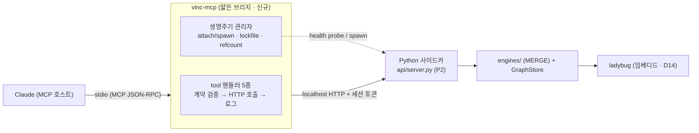

<!-- vinc-export
doc_id: vinc.mcp.skeleton
title: Vinc MCP 서버 · Push MVP 스켈레톤 설계
origin: Vinc-docs/vinc/MCP-SKELETON.md@5090690
chunks: 10
verified: true
content_hash: cd43c3178d38140e14014812d886f1c4d629cbebccd67f152994d405e05a65f4
updated_at: 2026-08-01T16:20:13.306Z
-->

---
doc_id: vinc.mcp.skeleton
layer: C
domain: mcp-skeleton
title: Vinc MCP 서버 · Push MVP 스켈레톤 설계 (how)
status: draft
authority: SSoT
version: v0.3
owner: vinc
last_updated: 2026-07-29
inherits_from: [vinc.mcp, vinc.arch]
tags: [vinc, mcp, skeleton, push, spawn, lifecycle]
---

# Vinc MCP 서버 · Push MVP 스켈레톤 설계

> [[vinc.mcp]](D11)가 "무엇을(계약)"을 정했다면, 본 문서는 "어떻게(구현 골격)"를 정한다.
> 범위 = **Push MVP**: Claude가 대화에서 저작한 fragment를 실시간으로 `vinc_ingest`로 밀어넣고,
> 읽기 도구로 조회하는 최소 동작. (Pull·관찰 패널은 후속 — 본 스켈레톤의 로그 형태 확정 후 진행.)

## 1. 결정 요약 (3 확정)
| # | 항목 | 결정 | 근거 |
|---|---|---|---|
| 1 | 전송 | **stdio(Claude) + 내부 HTTP 브리지** | Claude Desktop MCP 기본 stdio. 사이드카는 이미 `127.0.0.1` HTTP → 브리지가 기존 엔드포인트 재사용, 새 로직 0 |
| 2 | 생명주기 | **spawn (attach 우선, 없으면 띄움)** | 제약 최소화 — GUI 없이 Claude만 써도 동작. 단일 사이드카를 refcount로 공유 |
| 3 | MERGE 백스톱 | **엔진 내재(사이드카)**, MCP 서버는 순수 래퍼 | 원본 엔진이 id 정확 매칭 `MERGE`(노드/엣지). dedup은 기존 동작 |

> **명칭 주의(완료, v0.2).** 원본 파일명 `*_to_neo4j.py`는 흡수 원본(Neo4j 시절)의 **잔존명**이었다.
> **Vinc는 Neo4j를 쓰지 않는다 — 임베디드 ladybug(D14) 단일이다.** (v0.5.3 에서 kuzu 를 완전
> 제거했고 듀얼드라이버·마커 이관 레일도 폐기했다 — 그전까지 "kuzu 기본 · ladybug 옵트인"이라 쓴
> 자리는 전부 폐기된 서술이다. ladybug 는 Kùzu 계보라 방언·드라이버 동작 서술은 그대로 유효하다.) 엔진은 P0 GraphStore
> 추상화를 거쳐 백엔드 중립이며(Cypher는 임베디드 방언으로 렌더, §5–7). **DEC D3**의 `*_ingest` 리네이밍은
> "P1 이후"로 계보 보존을 위해 보류돼 있었으나, P1–P2·MCP Push MVP가 끝난 지금 실행됐다:
> `recall_to_neo4j.py`→`recall_ingest.py`·`bridges_to_neo4j.py`→`bridges_ingest.py`·
> `concepts_to_neo4j.py`→`concepts_ingest.py`·`learner_to_neo4j.py`→`learner_ingest.py`(git mv,
> 이력 보존). `graph_to_neo4j.py`는 애초에 Vinc 소관이 아니다(PM 정책 그래프, `weg-9000` 레포) —
> 이 리네임 대상이 아니며 본 문서가 인용하는 그 MERGE 로직(id 정확 매칭) 설명은 그대로 유효하다.

## 2. 컴포넌트 — 얇은 브리지

- **vinc-mcp**는 신규 모듈이지만 **비즈니스 로직 0** — 계약 검증 + HTTP 프록시 + 호출 로그뿐.
- 의미 판단·구조화·dedup 없음(전부 상류 Claude와 하위 엔진에 있음). 순수 엔진 철학 유지.

## 3. 생명주기 — spawn/attach (결정 2)
사이드카는 **단일 writer**(설계 §12 R4). GUI와 MCP가 같은 사이드카를 공유하되, 누구든 먼저 필요로 하면 띄우고 마지막이 나가면 내린다 — **lockfile refcount**.

```mermaid
sequenceDiagram
  participant M as vinc-mcp (start)
  participant L as lockfile (data_dir/sidecar.lock)
  participant SC as 사이드카
  M->>L: 읽기 (pid·port·token·refcount)
  alt 살아있음 (health 200)
    M->>SC: GET /health (token)
    SC-->>M: 200
    M->>L: refcount += 1 (attach)
  else 없음/죽음
    M->>SC: spawn (vinc-sidecar onedir | python -m api.server)
    SC-->>M: 기동 → port·session token 발급
    M->>L: 쓰기 (pid·port·token·refcount=1)
  end
  Note over M,SC: 이후 모든 tool 호출은 이 port+token 사용
  M->>L: 종료 시 refcount -= 1; 0 이고 내가 spawn 했으면 사이드카 terminate
```
- **token**: 사이드카가 기동 시 발급, lockfile에 저장(루프백 전용이므로 로컬 파일 권한으로 보호).
- **GUI와의 정합**: Tauri Rust 코어도 동일 lockfile refcount 규약을 따른다 → MCP가 먼저 띄운 사이드카에 GUI가 attach 가능(역도 성립). 종료 순서 무관하게 마지막 사용자가 정리.
- **경합**: lockfile 원자적 쓰기(임시파일+rename) + 파일락으로 spawn 중복 방지.

## 4. tool 핸들러 매핑 (계약 → HTTP)

> **v0.2 구현 델타.** 아래는 원안(v0.1) 그대로다. **실제 구현**(`Vinc/vinc_mcp/tools.py`)은
> `api/server.py`(P2)가 실제로 노출하는 파라미터 이름에 맞췄다 — 표 밑 "as-built" 열 참조.
> `vinc_decide`는 실제로 `GET`(원안은 `POST`)이고, `vinc_graph`는 현재 백엔드에 없는 기능이라
> 후속으로 남겼다(§10).

| MCP tool | 사이드카 호출(원안 v0.1) | 사이드카 호출(as-built, `vinc_mcp/tools.py`) | 비고 |
|---|---|---|---|
| `vinc_search` | `GET /search?q=…&limit=…&domain=…` | `GET /search?query=…&top_k=…&owner=…` | `q`→`query`, `limit`→`top_k`. **`domain` 은 현재 미전달**(§10-1 정정) — 대신 SEC-1 로 `owner` 를 항상 싣는다 |
| `vinc_recall` | `GET /recall?domain=…&tag=…&owner=…` | `GET /recall?domain=…&tags=…&owner=…&limit=…` | `tools.py` 가 단수 `tag`→복수 `tags` 변환(1개짜리 값으로 전달) |
| `vinc_graph` | `GET /graph?seed=…&depth=…` | **호출 안 함** — `{nodes:[],edges:[],executed:false,warnings:[…]}` 즉시 반환 | `/graph` 는 owner 스코프 전체 그래프뿐, seed+depth 순회 플랜이 `api/query.py` 에 없음(§10-2) — **§11 에서 해소**, 현행은 `GET /graph?seed=&depth=` 호출 |
| `vinc_decide` | `POST /decide {topic,depth}` | `GET /decide?topic=…&depth=…` | 실제 라우트는 GET(`api/server.py` `read_decide`) — 파라미터는 원안과 동일 |
| `vinc_ingest` | `POST /ingest {nodes,edges,owner}` | `POST /ingest/fragment {nodes,edges,owner[,theme_id]}` (§11) | `theme_id` 는 **선택**(명시→활성→`default` lazy 해결, `api/fragment.py` `_ThemeFold`). 타입은 주제 어휘로 해석, 어휘 밖은 proposed 편입(§10-3) |
| ~~`vinc_themes_*`~~ | (신규) | **없음 — HTTP 전용** `GET/POST /themes`·`/themes/activate` | 주제 CRUD 는 MCP 도구로 래핑되지 않았다(코드 실측 0건) |
| ~~`vinc_types_*`~~ | (신규) | **없음 — HTTP 전용** `GET /types`·`POST /types/{ratify,reject,rename}` | 타입 재가도 동일 — 어휘 확정은 사람의 행위라 호스트가 자율로 부를 자리에 두지 않았다 |

> **도구 목록의 정본은 위 표가 아니라 `vinc_mcp/tools.py` 의 `TOOLS` 다** — 현행 **18종**
> (읽기 12 · 쓰기 6, [[vinc.mcp#§4]]). 위 표는 Push MVP 시점의 5종 매핑 기록이며, 이후
> 조회 6종(`domains`·`suggest_ties` — D32, `neighbors`·`path`·`merge_candidates`·`diagnose` —
> E-G3~G7)·SEC-3 쓰기 3종(`delete`·`delete_edge`·`merge_nodes`)·D45 문서 4종(`doc_get`·
> `doc_list`·`doc_put`·`doc_delete`)이 더해졌다.

- **write 표면은 하나가 아니다(정정)**: 그래프 쓰기는 `vinc_ingest` 가 **주된** 표면이되
  정리·삭제 경로(`vinc_delete`·`vinc_delete_edge`·`vinc_merge_nodes`)와 문서 정본 쓰기
  (`vinc_doc_put`·`vinc_doc_delete`, [[vinc.c.chunk-ssot]])가 함께 있어 총 6종이다. 감사 경계는
  표면 개수가 아니라 도구 annotations(readOnly/destructive)와 owner 스탬핑이 세운다([[vinc.mcp#§4]]).
  핸들러는 [[vinc.mcp#§5]] **형태 검증(필수 키만 — 타입 enum 아님)** 후 전달. **타입 어휘 조회·편입은
  서버 측**(themes.json 에 닿는 사이드카/`fragment_ingest`)에서만 — MCP 프로세스는 HTTP bridge 만 가짐.
- 인라인 `/ingest`는 P2 `api/server.py`에 추가한 얇은 경로: `{theme_id,nodes,edges,owner}` fragment 를 받아
  `engines/fragment_ingest.py` 의 MERGE 로직에 위임(§10-3). 어휘 밖 타입은 주제 어휘에 `proposed` 편입(스킵 아님).

## 5. 파일/모듈 스켈레톤 (제안 → as-built)
신규 코드 레포(`Vinclums/Vinc`) 기준. 사이드카 하위에 얇게 둔다.

> **v0.2 구현 델타 — 패키지명 `mcp/` → `vinc_mcp/`.** 원안은 `Vinc/mcp/` 였으나, 실행 시
> 레포 루트가 `sys.path` 에 오르는 방식(다른 엔진과 동일)에서 최상위 패키지명을 `mcp` 로
> 두면 공식 MCP Python SDK(PyPI `mcp`, `server.py` 가 `from mcp.server.fastmcp import
> FastMCP` 로 의존)를 이 패키지 자신이 가려 임포트가 깨진다. 이름 충돌 회피가 유일한
> 목적이며, 그 외 파일 구성은 원안과 1:1이다.

```
Vinc/
  vinc_mcp/         # (원안 표기: mcp/ — 개명 사유는 위 델타 참조)
    __init__.py
    server.py        # stdio MCP 진입점 — 도구 등록·라우팅(FastMCP, extra `vinc[mcp]`)
    tools.py         # tool 핸들러(형태 검증 → bridge 호출 → 로그) — 현행 18종(읽기 12 · 쓰기 6).
                     # 주제/어휘는 MCP 도구가 아니라 HTTP 전용 라우트다([[vinc.mcp#§4]])
    bridge.py        # 사이드카 HTTP 클라이언트(port+token)
    lifecycle.py     # attach/spawn · lockfile refcount (결정 2)
    audit.py         # 도구 호출 로그(§6) 기록기
  engines/
    fragment_ingest.py  # POST /ingest 어댑터의 MERGE 로직(§10-3) — 물리 바인딩 라우팅
  store/
    theme_store.py      # 주제·타입 어휘 스토어(themes.json — 그래프 밖 메타) — 신규(D11-R2)
    migrate_themes.py   # 전역 enum → 주제 어휘 마이그레이션(§7) — 신규
  api/
    server.py        # (P2) 기존 엔드포인트 + 인라인 POST /ingest + /themes·/types CRUD
```
핸들러 시그니처(의사코드):
```
# tools.py — 타입 enum 검증 없음(어휘는 주제별 사용자 저작물, 서버가 편입)
def vinc_ingest(fragment: dict, theme_id: str) -> dict:
    if not theme_id: return reject                 # theme_id 필수(D11-R2)
    ok, warnings = validate_fragment_shape(fragment)   # 필수 키만(id/title)
    res = bridge.post("/ingest", {**ok, "theme_id": theme_id})  # 서버가 어휘 편입
    audit.record("vinc_ingest", fragment, res)      # §6 로그
    return {**res, "warnings": warnings + res.get("warnings", [])}  # proposed_types 포함
```

## 6. 도구 호출 로그 스키마 (관찰 패널 입력 — 후속 UI 확정용)
모든 tool 호출을 `data_dir/logs/mcp-audit.jsonl` 에 1줄/건 append. GUI 관찰 패널이 이걸 tail·집계한다.
```json
{
  "ts": "2026-07-05T15:40:00Z",
  "tool": "vinc_ingest",
  "source": "mcp",
  "session": "sess-…",
  "args_digest": { "nodes": 12, "edges": 8, "domains": ["fashion"] },
  "result": { "status": "ok", "created": {"nodes": 9, "edges": 8}, "matched": {"nodes": 3} },
  "warnings": [],
  "duration_ms": 41
}
```
- `args_digest`는 **원문 미포함**(개수·domain 등 요약만) — 로그 비대·민감정보 회피.
- 읽기 도구는 `result.count`만. 이 스키마가 확정돼야 관찰 패널 UI(설정 하위)를 정확히 그린다.

## 7. 미결·후속
- **인라인 `/ingest` 경로**(P2 `api/server.py`) 구현 — 파일 기반 엔진을 바디-기반으로 얇게 확장.
- **자율 vs 승인**: Claude 자율 적재 기본값 vs 사용자 승인 — 관찰 패널과 함께 결정(초기엔 자율 + 사후 로그 열람 권장).
- **Pull**: 과거 대화 이력 배치 마이닝 — 이력 출처(내보낸 로그 → `inbox/` 또는 memory MCP) 별도 DEC.
- **패키징**: `vinc-mcp` 를 사이드카와 함께 PyInstaller onedir 로 동봉(설계 §9).

## 8. dedup 정책 — exact-match 전용 (유사도 영구 제외)
(c) 하이브리드의 백스톱은 **`id` 문자열 정확 매칭 MERGE 하나뿐**이다. 임베딩 코사인 유사도·퍼지 매칭·
LLM 판단 기반 dedup은 **영구 제외**한다. 근거:
- 원본 엔진도 exact-match였다 → Vinc가 유사도 판단을 새로 들이면 "순수 엔진" 철학 이탈.
- 유사도 dedup을 Vinc가 하면 read-before-write 규약([[vinc.mcp#§3]])과 **책임이 중복·충돌**한다.
- 동일 개념의 서로 다른 id 를 합치는 책임은 **전적으로 상류 Claude**(적재 전 `vinc_search`/`vinc_recall`로
  기존 id 재사용)에 있다. Vinc는 정확-id 충돌만 흡수(안전망).

→ (c) 하이브리드 결정과 **정합**. 이 조항은 D11 §3의 구현 측 확정이다.

## 9. P2 인라인 ingest 검증 ↔ D11 fragment 스키마 1:1 대조표 (원안 v0.1)
실제 구현 직전 마지막 정합. 좌(D11 계약 필드, [[vinc.mcp#§5]]) ↔ 우(P2 어댑터 검증·동작).

> **D11-R2 상위 델타 — 타입 enum 검증 자체가 폐기됐다(§9·§10-3 공통).** 아래 표의 "type
> ∈ {enum} — 밖이면 warnings+skip" 모델은 **전면 교체**됐다. 타입은 전역 고정 enum 이 아니라
> **주제(theme)별 사용자 저작 어휘**(store/theme_store.py)이며, 어휘 밖 타입은 *스킵되지 않고*
> `status:proposed, provenance:ingest_proposed`로 어휘에 편입되어 응답 `proposed_types`에 담긴다
> (정보 손실 0 — THESIS T1·T3). `theme_id`가 fragment 필수 키로 추가됐다. 물리 라우팅은 이제
> "**어휘(frame)와 물리 바인딩(content) 분리**"다: 레거시 4노드/4엣지 타입은 전용 테이블,
> 그 밖의 사용자 저작 타입은 범용 `Entity`/`TYPED` 캐리어([[vinc.c.dataplane#§2]]). 아래 두 표의
> "enum 검증 — 밖이면 warnings+skip" 셀은 "**어휘 조회 — 밖이면 proposed 편입(스킵 아님)**"으로 읽는다.

> **v0.2 구현 델타 — 이 표는 원안이며 그대로 구현되지 않았다.** 실제 구현은 §10-3 이
> 정본이다: `record` 타입·`node.props{}` 자유 확장·`domain.id 키=domain_id`·`inherits_from`
> 관계는 **현재 임베디드 스키마(`store/embedded_schema.py`)에 대응 테이블/컬럼이 없어
> 미지원**이다(스킵+warnings). 이유와 실제 매핑은 §10 참조 — "투기적 열 금지"
> ([[vinc.c.dataplane#§2]]) 를 지키기 위해 스키마를 넓히는 대신 계약을 실제에 맞췄다.

| D11 fragment 필드 | P2 인라인 ingest 검증/동작 |
|---|---|
| `node.id` | 필수·문자열. **MERGE 키**(타입 접두 권장, 예 `concept:margiela`) |
| `node.type` (주제 어휘) | **어휘 조회 — 밖이면 `proposed` 편입(스킵 아님)**. 레거시 타입→전용 라벨, 그 밖→`Entity` 캐리어 |
| `node.title` | 필수·문자열 → 속성 |
| `node.domain` | 선택·자유 문자열(고정목록 금지) → 속성·스탬핑 |
| `node.tags[]` | 선택·문자열 배열 → 속성 |
| `node.props{}` | 선택 — 스키마-free 확장은 **여기서만** → 속성 |
| `edge.from` / `edge.to` | 양 끝 `node.id` 존재(또는 동일 fragment 내 생성) 후 MATCH |
| `edge.type` (주제 어휘) | **어휘 조회 — 밖이면 `proposed` 편입**. 레거시 pair→전용 REL, Entity 양끝→`TYPED` 캐리어 |
| `owner` | 선택·기본 `tenant:local` 스탬핑(설계 §3-3) |

`node.type` → GraphStore MERGE 키 (백엔드 중립, 임베디드 ladybug 방언 렌더 — Neo4j 아님):

| type | id 키 |
|---|---|
| record | `record_id` |
| concept | `concept_id` |
| domain | `domain_id` |
| bridge | `bridge_id` |
| episode | `episode_id` |

**반환(D11-R2)**: `{ merged:{ nodes:{created,matched}, edges:{created} }, skipped:0, proposed_types:[…], warnings:[…] }`.
어휘 밖 타입은 스킵되지 않고 `proposed_types`에 담긴다(어휘 사유 `skipped`는 구조적으로 0). 필수키(id/title)
누락·물리 토폴로지 한계는 개별 스킵 + warnings. §6 로그에 `created/matched/proposed_types/warnings` 집계 기록.

> 이 대조표가 곧 P2 인라인 `/ingest` 어댑터의 검증 스펙이다. 좌우가 1:1이므로 계약(D11)이 바뀌면
> 어댑터도 이 표 한 곳만 따라 바뀐다(정본 단일화).

## 10. v0.2 구현 델타(as-built) — Push MVP 완료분

MCP Push MVP 1차 구현(`Vinclums/Vinc` `vinc_mcp/` + `engines/fragment_ingest.py` +
`api/server.py` 인라인 `POST /ingest`)에서 원안(v0.1, §4·§9)과 실제 스키마
(`store/embedded_schema.py`, [[vinc.c.dataplane#§2]])가 어긋난 지점을 실측해 정정한다.

### 10-1. 읽기 4종 — 실제 파라미터 (§4 갱신)
§4 표 참조.

> **정정(2026-07-29 코드 실측).** v0.2 가 "`read_search` 에 `domain` 파라미터를 `filters` 로
> 전달하도록 얇게 배선을 추가했다"고 적었으나 **현행 코드에 그 배선은 없다.** `api/server.py`
> `read_search` 의 `filters` 는 **Chunk 실존 열인 `layer`·`doc_id` 뿐**이고, `domain`/`tag` 는
> Chunk 스키마에 열이 없어 **구조적으로 푸시다운 불가**다(코드 주석: Phase E3 — P4 스키마 델타로
> 이관). `vinc_mcp/tools.py` `_t_search` 도 `query`·`top_k`·`owner` 만 보낸다. 대신 그 자리에
> 들어온 것이 SEC-1 이다: owner 미전송이라 `node_hits` 가 남의 Concept/Record 를 돌려주던 구멍을
> 막느라 모든 읽기 도구가 owner 를 항상 싣게 됐다.

### 10-2. `vinc_graph` — 후속 (구현 안 됨)
D11 이 요구하는 "seed_id + depth 서브그래프 순회"는 `api/query.py` 에 대응 플랜이
없다 — 기존 `graph_plan(owner, domain)` 은 **owner 스코프 전체 Concept 그래프**이지
seed 기반 순회가 아니다. `owner=seed_id` 로 갈음하면 의미가 달라 오매핑이므로,
`vinc_graph` 툴은 사이드카를 호출하지 않고 `{nodes:[],edges:[],executed:false,
warnings:["vinc_graph not yet backed by a seed-based traversal query …"]}` 를 그대로
반환한다. 후속 작업: `api/query.py` 에 seed+depth 순회 플랜 추가 후 §4 표 갱신.

### 10-3. `vinc_ingest` — 실제 스키마로 축소(§9 정정)
`store/embedded_schema.py` 는 "투기적 열 금지"([[vinc.c.dataplane#§2]]) 원칙으로
**엔진이 실제로 쓰는 컬럼만** 선언한다. D11(§5)·§9 원안이 가정한 5 타입 전 지원·자유
`props{}`·5 관계 전 조합은 이 원칙과 충돌해 스키마를 넓히지 않고 **계약을 실제에
맞췄다**(`engines/fragment_ingest.py` 가 정본 매핑).

**node.type → 실제 라벨/id 키/세팅 가능 필드:**

| type | 지원 | 라벨 | id 키(§9 원안과 차이) | title | domain | tags | owner |
|---|---|---|---|---|---|---|---|
| concept | ✅ | Concept | `concept_id` | ✅ | ✅ | ✅ | ✅(owner_id) |
| domain | ✅(id만) | Domain | `name`(원안 `domain_id` 아님 — Bridge 의 `CROSSES` 관계가 이미 `name` 에 의존) | ❌ | ❌ | ❌ | ❌ |
| bridge | ✅(title만) | Bridge | `bridge_id` | ✅ | ❌ | ❌ | ❌ |
| episode | ✅ | Episode | `episode_id` | ✅ | ✅ | ✅ | ✅(owner_id) |
| record | ✅ **(해소)** | Record | `record_id` | ✅ | ✅ | ✅ | ✅(owner_id) |

> ⚠️ **위 표의 `record`·`props` 행은 v0.2 시점 기록이었다 — §11 이후 전부 해소됐다(2026-07-16
> 코드 실측).** `store/embedded_schema.py` 에 **`Record` 노드 테이블**과 **각 노드의 `props` 열**이
> 존재하며(`api/fragment.py` 가 JSON 직렬화로 영속), `node.props{}` 는 **지원된다**. 따라서 아래
> "항상 미지원" 서술은 폐기한다.

~~`node.props{}` 는 어떤 라벨에도 자유 확장 컬럼이 없어 항상 미지원~~ → **지원**(각 노드 테이블의
`props STRING` 열에 JSON 직렬화 저장 — D11 §5 자유 속성). 지원 안 되는 type/필드는 전체 실패가
아니라 개별 스킵 + `warnings`(D11 §5 "금지" 조항과 동형).

**edge.type → 실제 관계 테이블(허용 (from,to) 타입쌍):**

| type | 지원 | 관계 라벨 | 허용 쌍 |
|---|---|---|---|
| relates_to | ✅ | RELATED_TO | (concept, concept) |
| prerequisite_of | ✅ | PREREQUISITE_OF | (concept, concept) |
| derives_from | ✅ | DERIVES_FROM | (concept, concept) |
| connects_via | ✅ | CONNECTS | (bridge, concept) |
| inherits_from | ✅ **(해소)** | INHERITS_FROM | (concept, concept) |
| (record 부착) | ✅ **(해소)** | ATTACHES_TO{type} | (record, concept) — rel 테이블 FROM/TO 타입 고정 때문에 원 엣지 타입은 `type` 속성으로 보존 |

엣지 양 끝은 **동일 fragment 의 `nodes[]` 에 선언된 노드만** 인정한다(외부에 이미
존재하는 노드를 타입 선언 없이 참조하는 경로는 없음 — read-before-write 로 재발견한
기존 id 도 fragment 에 재기재해 병합한다는 전제, [[vinc.mcp#§3]] 와 정합).

### 10-4. MERGE 판별(created/matched)
ladybug 드라이버(Kùzu 계보)는 MERGE 의 생성/매치 여부를 별도로 반환하지 않는다(원본 엔진들도 이
집계를 쓰지 않았다 — D11 이 신규로 요구). `engines/fragment_ingest.py` 는 MERGE 전
`MATCH`로 존재를 먼저 확인해 `created`/`matched` 를 센다(노드당 질의 2회 — 대화형
소량 fragment 규모에서 성능 영향 무시 가능).

## 11. P5 as-built 갱신 (2026-07-11) — 어댑터 재구현·전송 2종

P5 선행 트랙에서 `vinc_mcp/` 를 재구현했다(레포에 §5 원안 패키지가 부재했던
문서-코드 델타 해소). §5·§10 대비 확정 변경:

- **stdlib 전용 확정** — FastMCP(공식 SDK) 대신 표준 라이브러리 JSON-RPC 구현.
  근거: F5(외부 의존 0)·사이드카 http.server 와 동일 원칙·PyInstaller 동결
  무증분(33MB 유지, 동결 stdio 왕복 실측). extra `vinc[mcp]` 는 불요해졌다.
- **§10-2 해소** — `vinc_graph` 는 P3 에서 추가된 seed+depth ego 순회
  (`/graph?seed=&depth=`)를 호출한다(실측: 실스토어 seed 1건 → 13노드·82엣지).
- **도구 7종(P5 시점)** — D11 5종에 `vinc_domains`·`vinc_suggest_ties`(D32) 추가.
  이 시점엔 쓰기가 `vinc_ingest` 하나였다(`POST /ingest/fragment`, api/fragment.py 정본).
  → **현행은 18종**(읽기 12 · 쓰기 6): 이후 E-G3~G7 조회 4종(`neighbors`·`path`·
  `merge_candidates`·`diagnose`), SEC-3 쓰기 3종(`delete`·`delete_edge`·`merge_nodes`),
  D45 문서 4종(`doc_get`·`doc_list`·`doc_put`·`doc_delete`)이 더해졌다. "쓰기는 하나"는
  P5 시점의 사실이며 **지금은 아니다** — 정본 목록·주석은 [[vinc.mcp#§4]].
- **전송 2종** — stdio(newline-delimited)와 Streamable HTTP(루프백 8790,
  정적 bearer 또는 OAuth 게이트: RFC 9728/8414 메타데이터·동적 등록·PKCE S256·
  리프레시 회전·관리 키 승인, 시크릿은 서버 env 전용 — D36). 무인증 기동 거부.
- **등록 자동화** — `vinc mcp install --client code|desktop`(desktop = 백업 후
  병합, code = 공식 CLI 호출·부재 시 수동 명령 안내). 양 경로 라이브 실측.
- **생명주기 축소** — §3 lockfile refcount 대신 attach 우선 + 미가동 시 spawn
  (우리가 띄운 프로세스만 종료 시 정리). refcount 는 GUI 공유 시점에 재평가.
- **§6 감사 로그 미구현 유지** — 관찰 패널 UI 확정과 함께 후속.

## 부록 Z. 미분류 원문 사실
(없음)
