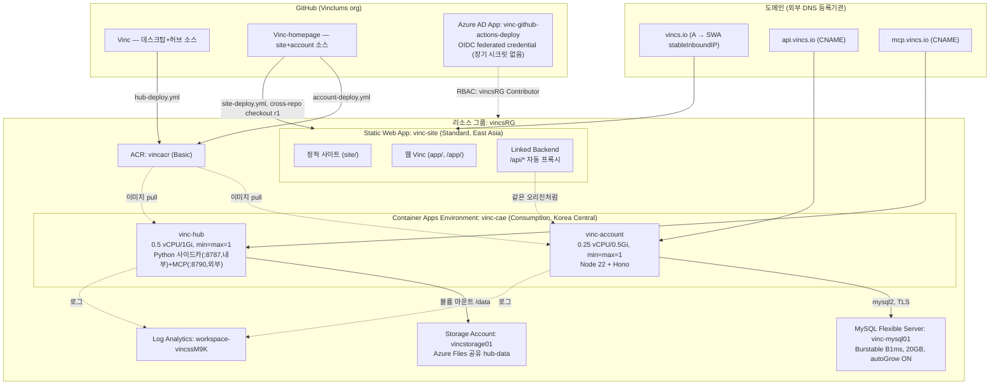

<!-- vinc-export
doc_id: vinc.ops.azure-architecture
title: AZURE-ARCHITECTURE — Vinc Azure 인프라 구성 (as-built)
origin: Vinc-docs/vinc/AZURE-ARCHITECTURE.md@5090690
chunks: 4
verified: true
content_hash: fa388330ffd867130b6b32ffff2e449da620587d90c63690cab7dbbabb903b4b
updated_at: 2026-08-01T16:20:43.329Z
-->

> 정본은 리포 파일입니다. 이 사본은 검색용 스냅샷(2026-08-02)입니다.

# AZURE-ARCHITECTURE — Vinc Azure 인프라 구성 (as-built)

> 2026-07-28/29 가비아 클라우드 전면 삭제에 따른 Azure 이관 결과물. 배포 절차는
> `DEPLOYMENT.md`, 비용은 `AZURE-COST-MANAGEMENT.md` 참조. 이 문서는 **"지금 뭐가
> 떠 있는가"** 의 스냅샷이다 — 실제 현재 상태는 항상 `az resource list -g vincsRG`
> 로 재확인할 것(리소스는 이 문서보다 빨리 바뀐다).

## 1. 왜 이 구성인가 — VM(IaaS) 대신 3종 PaaS

원래 계획은 가장 저렴한 단일 VM(B1s, 월 ~$8) + Docker Compose 였다. 그런데 이
구독(신규 생성 직후)이 **전 세계 모든 리전에서 `Microsoft.Compute` VM 프로비저닝을
거부**했다(`NotAvailableForSubscription` — quota 는 정상 표시, 실제 승인만 안 나는
상태. 한국·일본·동남아·미국·유럽 6개 리전에서 B1s·D2s_v3 둘 다 동일하게 막힘을
실측 확인). 원인은 신규 구독에 대한 Azure 의 사기방지 리전 접근 제한으로 추정되며,
해제하려면 Azure Portal → Help+support → Service and subscription Limit(quotas) →
Compute-VM 티켓이 별도로 필요하다(미제출 상태).

**VM 이 아닌 리소스 프로바이더는 전부 정상**이었다(`Microsoft.App`·
`Microsoft.DBforMySQL`·`Microsoft.Web`·`Microsoft.ContainerRegistry`·
`Microsoft.Storage`) — 그래서 Container Apps(Consumption) + MySQL Flexible
Server + Static Web Apps 조합으로 우회했다. 이건 원래 계획(옵션 A, 최소비용)보다
비싸지만(§비용은 AZURE-COST-MANAGEMENT.md), 실사용 검증까지 이미 끝난 상태다.

## 2. 아키텍처 다이어그램

## 3. 리소스 인벤토리

| 리소스명 | 타입 | SKU/티어 | 리전 | 용도 |
|---|---|---|---|---|
| `vinc-cae` | Container Apps Environment | Consumption | Korea Central | 계정·허브 컨테이너 호스팅 |
| `vinc-account` | Container App | 0.25 vCPU/0.5Gi, min=max=1 | Korea Central | 계정 백엔드(Hono) |
| `vinc-hub` | Container App | 0.5 vCPU/1Gi, min=max=1 | Korea Central | 사이드카(:8787 내부)+MCP(:8790 외부) |
| `vinc-mysql01` | MySQL Flexible Server | Burstable B1ms, 20GB Premium_LRS | Korea Central | 계정 DB(`vinc_account`) |
| `vincacr` | Container Registry | Basic | Korea Central | 컨테이너 이미지 저장 |
| `vincstorage01` | Storage Account | Standard_LRS | Korea Central | 허브 그래프 DB 영속화(Azure Files) |
| `vinc-site` | Static Web App | **Standard** | East Asia(SWA 미지원: Korea Central) | 정적 사이트+웹 Vinc, Linked Backend |
| `workspace-vincssM9K` | Log Analytics Workspace | 기본(PerGB2018 추정) | Korea Central | Container Apps 로그 수집(자동 생성) |
| `mc-vinc-cae-api-vincs-io-*` | Managed Certificate | 무료 | - | `api.vincs.io` TLS |
| `mc-vinc-cae-mcp-vincs-io-*` | Managed Certificate | 무료 | - | `mcp.vincs.io` TLS |

## 4. 네트워킹 · 도메인

| 도메인 | 레코드 | 대상 | 검증 |
|---|---|---|---|
| `vincs.io`(apex) | A | SWA `stableInboundIP`(예: `57.158.92.245`, 재발급 시 바뀔 수 있음 — 재확인: `az resource show --ids <SWA 리소스ID> --query properties.stableInboundIP`) | TXT `@` = SWA `validationToken` |
| `api.vincs.io` | CNAME | `vinc-account.<env-domain>.koreacentral.azurecontainerapps.io` | TXT `asuid.api` = Container Apps Environment `customDomainVerificationId`(계정·허브 공유값) |
| `mcp.vincs.io` | CNAME | `vinc-hub.<env-domain>.koreacentral.azurecontainerapps.io` | TXT `asuid.mcp` = 위와 동일 값 |

**apex 도메인 주의**: `ALIAS`/`ANAME`/CNAME flattening 을 지원하는 DNS 라면 A 대신
그걸로 SWA 호스트네임을 직접 가리키는 게 성능상 낫다(글로벌 분산 유지). A 레코드는
단일 리전 호스트로 고정되는 폴백.

**MySQL 방화벽**: `AllowAllAzureServicesAndResourcesWithinAzureIps`(Azure 내부
트래픽 전체 허용) — Container Apps 의 아웃바운드 IP 가 수십~수백 개로 동적이라
개별 IP 화이트리스트가 불가능해서 이 방식을 채택. 외부 공인 인터넷에서의 직접 접근은
막혀 있지 않다는 뜻이므로, 계정(DML)/DDL 계정 자격증명 자체가 유일한 방어선이다
(§AZURE-COST-MANAGEMENT.md 에 위험으로 별도 기재는 안 했으나 보안 관점에서 인지할
것 — 필요시 Private Link/VNet 통합으로 강화 여지 있음, 별건).

## 5. IAM · CD 인증

| 항목 | 값 |
|---|---|
| Azure AD App | `vinc-github-actions-deploy` (appId `7e9c111d-1fde-46a4-be57-c18cc66781eb`) |
| Federated credential | `Vinclums/Vinc:main`, `Vinclums/Vinc-homepage:main` (OIDC, 장기 시크릿 없음) |
| RBAC | Contributor, **`vincsRG` 리소스 그룹 범위로 한정**(구독 전체 아님 — 최소권한) |
| ACR 인증 | Container Apps 는 ACR admin 자격증명(username/password, Container App 의 `secrets`)으로 이미지 pull — OIDC 로그인 세션과는 별개 |

## 6. 데이터 영속성

- **MySQL**: 관리형(자동 백업 매일 1회, 7일 보관, `geoRedundantBackup: Disabled`).
- **허브 그래프 DB**: 컨테이너 로컬 파일시스템이 아니라 **Azure Files 볼륨**(`/data`)에
  둬서 컨테이너 재시작·리비전 교체에도 살아남는다(실측 검증 완료). 이 볼륨 자체의
  백업은 **별도로 설정돼 있지 않다** — Azure Files 는 스냅샷 기능이 있으나 아직 미적용
  (개선 여지, 별건).

## 7. 알려진 제약 / 향후 재검토 여지

1. **VM 프로비저닝 제한이 풀리면**: 원래 계획(단일 VM, 월 ~$8)이 지금 구성(월
   ~$60~100 대, `AZURE-COST-MANAGEMENT.md` 참조)보다 훨씬 저렴하다 — Support 승인
   후 비용 재검토 가치 있음. 단, 지금 구성은 관리형 서비스의 이점(자동 백업·리비전
   롤백·관리형 TLS)을 이미 누리고 있어 단순 비용만으로 되돌릴 결정은 아니다.
2. **계정 백엔드 세션 쿠키에 `domain` 속성 없음** — Linked Backend(같은 오리진)
   전제라 지금은 무해하지만, 향후 `api.vincs.io` 직접 호출 클라이언트가 생기면
   문제가 된다(DEPLOYMENT.md §3.3).
3. **Azure Files 볼륨 스냅샷 미설정** — 허브 데이터의 실질적 백업이 없다시피 함(관리형
   MySQL 만큼의 보호가 없음).
4. **MySQL DDL 계정 분리가 완전하지 않음** — 최초 부트스트랩은 admin 으로 실행됨,
   다음 마이그레이션부터 `vinc_acct_ddl` 사용 권장(DEPLOYMENT.md §5.1).
