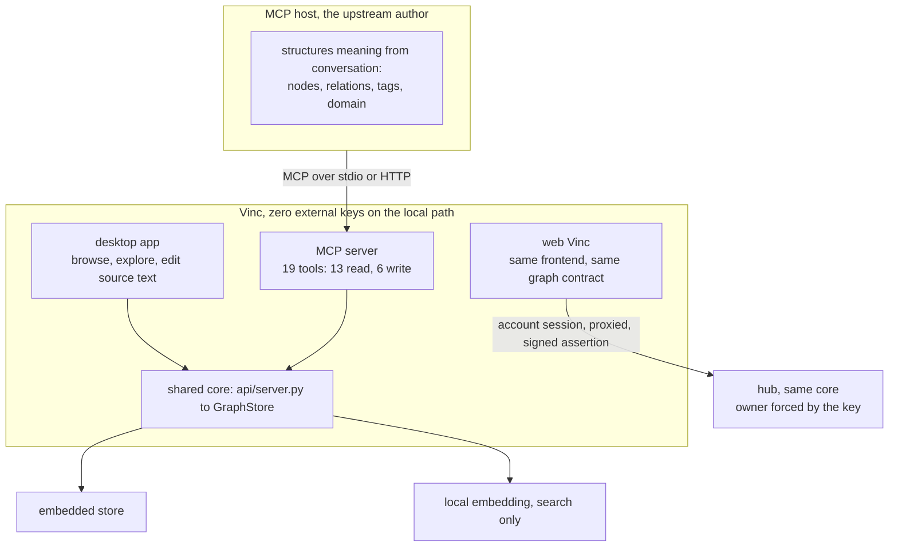

# MCP interface and tool contract

> `adr-engineering-011`. Vinc exposes an MCP server as a second front door beside the desktop app.
> Upstream authoring, turning prose into meaning and relations, happens in the user's **MCP host**
> using its conversational context. Vinc wraps its existing endpoints as tools. The intelligence
> lives outside Vinc, which is why this does not break the offline invariant.
>
> **Host neutral.** There is no vendor clause in this contract. The host can be any assistant that
> speaks MCP. Where an earlier version of this document named one vendor it meant "MCP host", and
> the implementation was neutral from the start: the tool and RPC modules contain no vendor string.

## 1. Why a second door

The original system had two layers: an LLM authored meaning, then a deterministic engine stored it.
Vinc absorbed only the second, so on its own it could not structure material the way a person wanted.

Putting an authoring LLM inside Vinc would break the offline invariant, so it is not there.
Instead the assistant the user already uses takes the author's role, and Vinc becomes a local tool
that host calls. The original philosophy is unchanged, that meaning is conferred upstream and Vinc
carries it. Only the timing moved, from batch authoring to authoring inside a conversation.

Not binding the author to one vendor is a **consequence** of that arrangement, not a separate
policy: if the intelligence is outside, it should not matter whose outside it is.

## 2. One core, three front doors



The third door builds the **same frontend source** with a different base path and speaks the
**same graph contract**. The only difference is where that contract lands: a hosted graph behind an
account session rather than a local sidecar.

The MCP door is likewise not local only. Every tool accepts `target: local | remote`, and on the
remote path the key fixes the owner.

## 3. Read before write

A host arriving over MCP does not know the existing graph state, so it will invent nodes and create
duplicates. The original system always joined on **exact string id**. That is now stated as contract.

**Responsibility is split.**

- **The host** calls `vinc_search` or `vinc_recall` before `vinc_ingest`, reuses any id it finds,
  and builds its fragment from those. This is a covenant, not an enforcement
- **The server** MERGEs on **exact id match** only. It updates when the id exists and creates when
  it does not. **It makes no similarity or meaning judgment**, which keeps the engine pure

**Hosts honor the covenant unevenly, so the cleanup path is part of the contract.** A host that
does not read first accumulates near-duplicates such as `concept:margiela` and
`concept:maison-margiela`. The server does not block them, because blocking would require the
meaning judgment the engine refuses to make. It reverses them instead: `vinc_merge_candidates`
proposes and `vinc_merge_nodes` folds. The cost of host diversity is therefore **more merge
cleanup, not failure**, and those two tools exist for that reason.

The channel for this instruction is the **tool description**, not a system prompt. For a weaker host
that description is the only channel there is.

## 4. The tools: 19, verified against the registry

`vinc_mcp/tools.py` is the authority. The default path is the local sidecar on loopback with a
session token, and that path works offline. Every tool also accepts `target`, where `remote`
reaches the account graph and the key fixes the owner. The contract is identical on both.

> **Count correction, 2026-08-06.** Earlier text said "18 tools, 12 read" in one place and
> "19, 13 read" in another. Counted from the registry: **19 tools, 13 read and 6 write.** The
> thirteen and six below are the verified split.

**Read, no side effects**

| Tool | Input | Output |
|---|---|---|
| `vinc_search` | `query, limit, owner` | chunk matches plus `node_hits`, the latter always populated by a title scan |
| `vinc_recall` | `owner, domain, tags, limit` | recent episodes |
| `vinc_graph` | `seed_id, depth 1 to 4, owner` | ego traversal, nodes and edges |
| `vinc_decide` | `topic, depth, owner` | nodes, edges, conflicts. Deterministic |
| `vinc_domains` | `owner` | domains found in the data. An **open set**, never a fixed list |
| `vinc_conventions` | `owner, lang` | the writing conventions, or a default filled from the live vocabulary when no document exists |
| `vinc_suggest_ties` | `node, limit, owner` | link candidates by tag and domain proximity |
| `vinc_neighbors` | `node, limit, owner` | one-hop neighbors with per-relation counts |
| `vinc_path` | `a, b, max_depth` | all shortest paths including ties |
| `vinc_merge_candidates` | `limit, min_score, owner` | deterministic title-similarity candidates. Never merges |
| `vinc_diagnose` | `kind: components or communities` | orphans and islands, or measured clusters |
| `vinc_doc_get` | `doc_id` | reassembled text with a losslessness check |
| `vinc_doc_list` | `owner` | document list |

**Write**

| Tool | Input | Output |
|---|---|---|
| `vinc_ingest` | fragment, section 5 | merge counts, `proposed_types`, warnings |
| `vinc_delete` | `node_id`, type-prefixed | detach delete counts |
| `vinc_delete_edge` | `from_id, to_id, type` | edge counts, writes a tombstone so deletion propagates through sync |
| `vinc_merge_nodes` | `keep_id, drop_id` | repointed, skipped, dropped |
| `vinc_doc_put` | `text, doc_id, title, origin` | doc id, chunk count, content hash. Identical text is a no-op |
| `vinc_doc_delete` | `doc_id` | deleted chunk and metadata counts |

The four document tools are the surface of the document-canon contract. Its losslessness rules are
stated in [[vinc.canon.chunk-ssot]]; this document only defines their MCP exposure.

### 4.1 Vocabulary is HTTP only, and that is deliberate

Theme and type manipulation exists as sidecar HTTP routes and is **not wrapped as MCP tools**.
An earlier version of this document listed seven such tools in the tool table. That was an error,
not a contract: they were never implemented.

The absence turns out to be right. Ratification is a human act, so it does not belong in a place a
host can reach on its own initiative. See [[vinc.canon.vocabulary-model]].

| Route | Purpose |
|---|---|
| `GET /themes`, `POST /themes`, `POST /themes/activate` | theme list, idempotent create, activate |
| `GET /types` | read a theme's vocabulary |
| `POST /types/ratify`, `/reject`, `/rename` | write, **user approval assumed** |

### 4.2 Safety annotations

`_ANNOTATIONS` is the authority. These are **required**, not optional: a remote MCP directory
submission is rejected without them. Hosts use them to decide confirmation prompts and
auto-approval policy.

| Tool | readOnly | destructive | idempotent |
|---|---|---|---|
| the thirteen read tools | true | | |
| `vinc_ingest`, `vinc_doc_put` | false | false, additive MERGE and hash idempotence | true |
| `vinc_delete`, `vinc_delete_edge`, `vinc_doc_delete` | false | true | true |
| `vinc_merge_nodes` | false | true, the dropped node's title and props are discarded | false |

`destructiveHint` **defaults to true** in the specification, so a non-destructive write must say
`false` explicitly or hosts will over-warn about it.

**Annotations are hints, not a trust boundary.** Enforcement is server side: owner stamping and
quota in `resolve_auth`.

> **The write surface is six, not one.** An earlier claim that "graph writes are `vinc_ingest`
> alone" was already false once the deletion and merge tools and the document tools shipped.
> The audit boundary is not the number of surfaces but the annotations plus owner stamping: two
> additive idempotent writes and four irreversible ones are distinguished by annotation, and
> neither kind can reach outside its owner. `vinc_ingest` is still the primary write surface and
> the rest are the cleanup path section 3 predicted.

## 5. The ingest fragment schema

```json
{
  "theme_id": "fashion_criticism",
  "nodes": [
    {
      "id": "concept:margiela",
      "type": "deconstruction",
      "title": "Maison Margiela",
      "domain": "fashion",
      "tags": ["deconstruction"],
      "props": { "note": "" }
    }
  ],
  "edges": [
    { "from": "concept:margiela", "to": "concept:deconstruction", "type": "influenced" }
  ],
  "owner": "user:local"
}
```

**MERGE rules.** A node matches on exact `id` and updates `title`, `domain`, `tags`, and `props`.
An edge matches on exact `(from, type, to)` after both endpoints have matched. `type` is resolved
against the **theme vocabulary**, not a global constant. The matching semantics never changed; only
where the type is interpreted moved.

The five legacy kinds route to dedicated tables. Anything else the user authors goes to the general
carrier. See [[vinc.spec.dataplane]].

**Outside the vocabulary means provisional, not skipped.** An unknown `type` is folded into the
vocabulary as `proposed` with `ingest_proposed` provenance and reported in `proposed_types`.
Nothing is lost, and the system never silently confirms its own proposal. The host is expected to
show `proposed_types` to the user and route them to ratification.

**`theme_id` is optional and lazily resolved.** An earlier version said it was required and that
ingestion should be rejected without it. That is withdrawn.

### 5.1 Two fields the schema does not declare but the store persists

**This is a live defect in the contract, found 2026-08-06.**

The node schema above declares `id`, `type`, `title`, `domain`, `tags`, and `props`. It does **not**
declare `date` or `summary`. But `api/fragment.py` persists both of them for an Episode.

The consequence is exactly what a hidden contract produces: an assistant writing episodes through
MCP has no way to know those fields are accepted, so it does not send them, so the column stays
empty. Nine of the most recently written episodes have a null `date` while carrying the date in
their id and props. Any timeline view built on that column will be wrong, and the cause will look
like a rendering bug rather than a schema omission.

**The fix belongs in the schema, not in a convention document.** Until it lands, a writer that
needs a dated Episode must send `date` and `summary` even though the schema does not advertise
them, because the data path does accept them.

This is the same class of problem as the edge type that ran for eighty-eight edges without
appearing in the published contract. See [[vinc.canon.graph-conventions]].

**Stamping.** `owner` defaults to the local tenant. There is no billing or external account concept
here, per [[vinc.canon.terminology]].

**Embedding.** Ingested nodes and chunks are embedded in the background for the search index only.
Embeddings are never used for linking or structuring.

## 6. Observation panel

MCP is a headless interface, not a new surface. The one concession is a connection and tool-call log
under Settings, so a user can see what was written and when. MCP does not create GUI surfaces of its
own, and that clause survives every shell redesign.

## 7. Open items

- **Pull-style mining** of past conversation history, after the push path is settled. The hard part
  is not the mining but the provenance: host session logs are not reachable over MCP
- **Autonomy versus approval.** Whether a host may ingest on its own initiative by default
- **A standard connector surface** for hosts that expect a `search` and `fetch` tool pair outside
  developer mode. A thin alias over `vinc_search` would satisfy it without adding capability, but
  it is a pure host-adaptation layer and needs a decided home. Deferred

**Resolved.** Both transports are live. The four implementation deltas that once separated this
contract from the running system, the record kind, free-form props, the inheritance edge, and
seed-plus-depth traversal, are all closed. Sections 4 and 5 are as-built.

## 8. Host portability

The contract assumes only the MCP specification. Vendor coupling exists only in registration
conventions, which are outside the contract.

| Layer | Vendor coupled | Evidence |
|---|---|---|
| Tool contract | **no** | JSON-RPC plus JSON Schema, zero vendor strings in the tool and RPC modules |
| Transport | **no** | as specified |
| Remote authorization | **no** | standard OAuth discovery, dynamic registration, and PKCE. Two major hosts have the same requirements |
| Local registration | yes, thin | absorbed by one installer module. Only two conventions exist: merge into a JSON file, or delegate to the host's own CLI |
| Browser CORS allowlist | yes, thin | applies only to hosts that run in a browser |

A host outside the registry works identically; it simply lacks automatic registration, and
`vinc mcp manual` prints the snippet to paste.

**MCP is a property of the host application, not of a model.** "Does it support model X" is the
wrong question. "Is that CLI an MCP host" is the right one.

Protocol version negotiation answers an unknown requested version with the **latest** rather than
falling back, because falling back would needlessly downgrade a host that negotiates a newer
revision. Sessions are not issued by the server, which the specification permits. A client-chosen
value is used as given, with a ceiling on how many are tracked.
