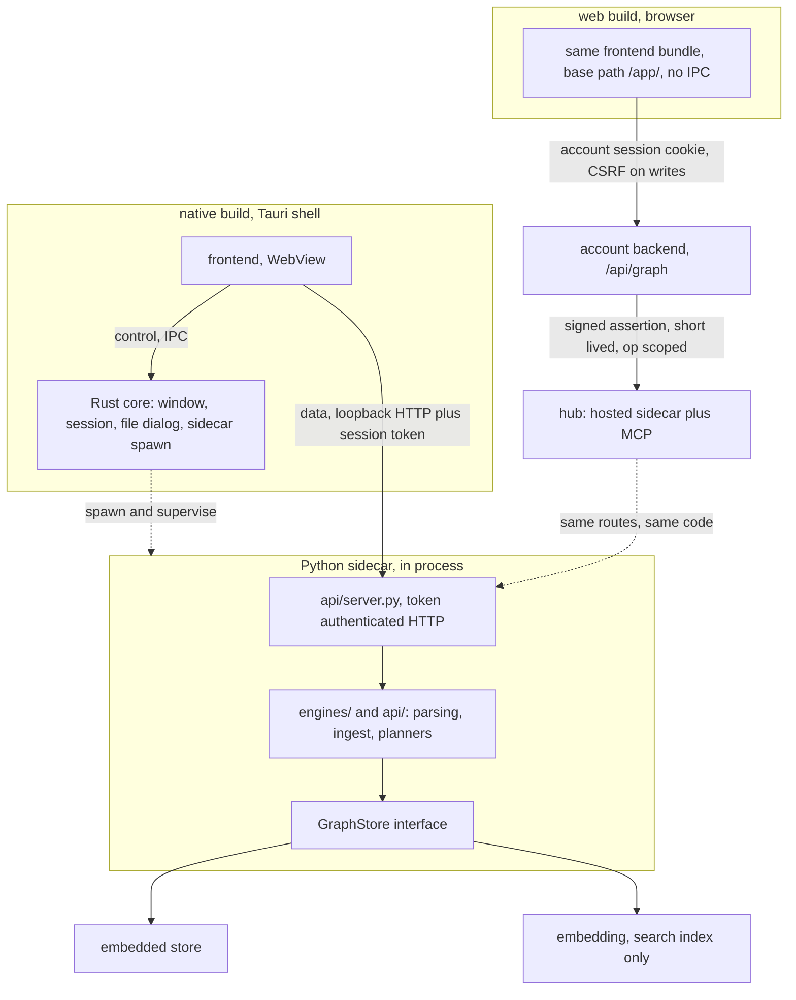
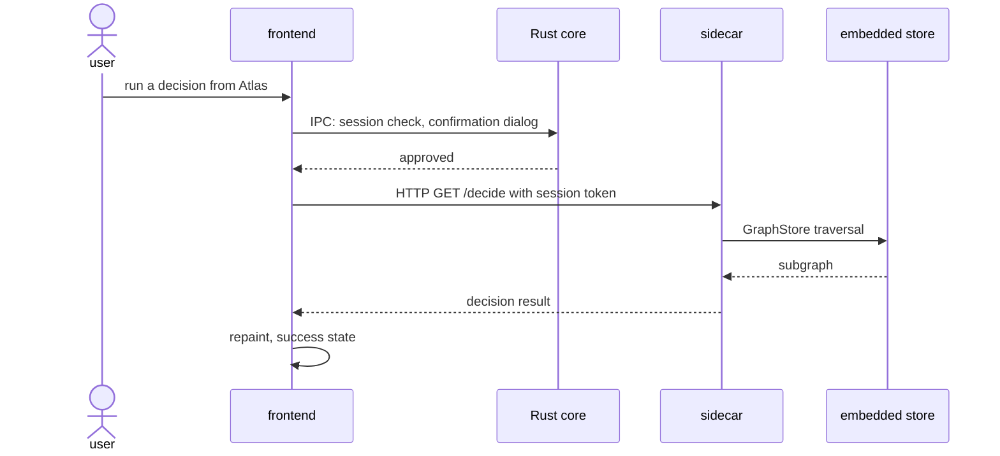

# System architecture, two builds over one contract

> The map: which process holds what, which channel a request takes, and where the two builds
> diverge. It deliberately owns no contract of its own. Invariants are in
> [[vinc.canon.principles]], the store and schema in [[vinc.spec.dataplane]], the tool contract in
> [[vinc.canon.mcp-contract]], the surfaces in [[vinc.spec.surface-tree]]. Restating any of them
> here would create a second copy that drifts.
>
> The live code in `Vinculums/Vinc` is the authority. Measurements carry their date.

## 1. One core, two builds

The same frontend source in `app/` ships twice. The **native** build runs inside a Tauri shell and
talks to a Python sidecar on loopback with a session token. The **web** build is the same bundle
with a different base path, pointed at `/api/graph` instead, and reaches a hosted sidecar through
the account backend.

The point of the arrangement is that **the graph contract does not fork**. Routes, payloads and
response shapes are identical on both; the only difference is the authentication path. A feature
written once therefore appears on both builds, and a divergence between them is a bug rather than
a design.

### 1.1 The owner never travels in a request body

Neither the frontend nor the account backend accepts an owner from the caller. The account signs a
short assertion naming the member, the hub pins the account's **public key only** and verifies it,
then stamps `forced_owner` from the subject and pops any owner the body carried.

The reason to force rather than validate is that validation has a default case and forcing does
not. One member session cannot reach another member's graph even if every layer above it is
compromised into asking. This is the transport-level half of the ownership rules; the store-level
half is in [[vinc.spec.dataplane]] and the decisions are `adr-security-001`, `adr-security-003`
and `adr-security-102`.

### 1.2 A new route has to be registered in three places

Proxying is an allowlist, not a passthrough. An operation reaches the web build only if it appears
in the sidecar routes, in the hub's proxy operation map, and in the account's own allowlist.

Miss one and **that feature alone dies quietly on the web** while the native build keeps working,
which is why it took a real incident to notice. Global vocabulary, the desktop-to-account sync
machinery, and local file backup are excluded on purpose, so the allowlist is not merely a
performance filter.

## 2. Control and data are different channels

The split is not decoration. Anything that needs the operating system (windows, the session, a file
dialog, spawning and supervising the sidecar) goes over IPC, and anything that touches the graph
goes over HTTP. Keeping the graph off IPC is what lets the identical frontend run in a browser
where no IPC exists: the web build simply loses the middle leg and gains the account and hub legs
described in section 1. Routes and response bodies do not change, so the client swaps a base path.

**The loopback port is not fixed.** When the MCP bridge starts a sidecar it takes an
operating-system-assigned free port and the sidecar rebinds to it, which was adopted to end
collisions with a stale sidecar. Any document or script that hardcodes 8787 for the local path is
describing an older arrangement.

## 3. Knowledge enters three ways

1. **A fragment authored by an MCP host**, arriving at `/ingest/fragment`. The upstream structuring
   happens outside Vinc, which is what keeps the offline invariant intact. Contract in
   [[vinc.canon.mcp-contract]]
2. **A pack import**, merged through `/ingest/pack`. Contract in [[vinc.canon.share-pack]]
3. **Document canon**, source text carried into the graph as chunks and concepts derived from it
   mechanically. Contract in [[vinc.canon.chunk-ssot]]

The third path is the one that changed the old description of this system. Before it, the app
genuinely did not read source text. **It does now**, through `/doc/put` for text, `/doc/put-file`
for bytes including PDF, the MCP document tools and the in-app editor. Derivation reads markdown
headings; there is no model, no network call and no external API in it, so reading source text did
not cost the offline property.

The intake surface and its file-type routing are owned by [[vinc.spec.surface-intake]].

## 4. What the native boundary forbids, and where it stops

The native build ships with no billing, no external authentication, and no learning-progress
narrative. `scripts/gate_forbidden.py` enforces the vocabulary side of that in continuous
integration, and [[vinc.canon.terminology]] is the list.

The web build sits **outside** that boundary by construction: it authenticates against an account
and therefore has a session, a plan, and quotas. "No external round trip" is a property of the
native build only. Reading a claim about offline behavior without checking which build it applies
to is the single most common misreading of this system.

The first screen is not a login on native, because the local profile has no passphrase by default
(`adr-design-007`); a lock is an opt-in setting. The web build is the exception, where a boot gate
checks the account session first.

## 5. Where data lives

A single folder is the data home: the store file, inbox, packs, models and profile all under one
directory, so a backup is a folder copy (`adr-engineering-043`). The hub instead mounts a network
share and puts the same layout under it, which is why the hub tolerates container replacement.
That topology is in [[vinc.spec.azure-infrastructure]].

## 6. Search and embedding: what actually runs

This is the section that was most wrong in the previous version, which described a single local
embedding model as if it ran everywhere.

**The packaged desktop sidecar has no embedding stack at all.** The PyInstaller specification
excludes the tensor and transformer libraries outright to avoid a multi-gigabyte binary. So on
desktop, full-text search works and vector search is simply absent, and a document written locally
is stored with a pending-embedding flag that nothing on that machine will ever clear.

**The hub fills vectors with a self-hosted worker**, running on ONNX rather than a tensor runtime
because the container ceiling would make an out-of-memory kill take the MCP server down with it.
The worker pulls pending chunks over loopback and posts vectors back, so **source text never leaves
the process boundary**. The model moved to a multilingual one on 2026-08-01 after measurement
showed the English-only model had no Korean syllable tokens at all, which had quietly broken Korean
retrieval.

> **Known gap, 2026-08-06.** On the hub that worker starts and has never loaded its model, so no
> vectors exist anywhere in the corpus and every query is answered by full-text search alone.
> This is an operational failure, not a design property. See [[vinc.plan.embedding-pipeline]].

> **Known inconsistency, 2026-08-06.** Two model registries disagree. The store configuration still
> maps the default model identifier to the English-only model at 768 dimensions, while the hub
> worker resolves a different multilingual model at the same 768 dimensions. The dimension matching
> is why nothing fails loudly. Whether the configuration label should be renamed is a question for
> [[vinc.plan.embedding-pipeline]], not for this document.

## 7. The MCP door

Vinc exposes an MCP server beside the app, so a host can author into the graph from a conversation
(`adr-engineering-011`). There are **19 tools, 13 read and 6 write**, and `vinc_mcp/tools.py` is the
authority for that list. Vocabulary manipulation is intentionally not among them and remains HTTP
only.

The contract is [[vinc.canon.mcp-contract]]; the server implementation, its transports and its
lifecycle are [[vinc.spec.mcp-server]]; the opt-in remote profile is [[vinc.spec.remote-profile]].

> **Correction.** Earlier versions of this document said eighteen tools and named a
> `vinc_themes_*` and `vinc_types_*` family that has never existed in code. Counted from the
> registry on 2026-08-06: nineteen.

## 8. What this document does not own

| Subject | Owner |
|---|---|
| Invariants, embedded backend contract, dialect | [[vinc.canon.principles]] |
| Store, schema, ingest paths, query surface, sync | [[vinc.spec.dataplane]] |
| MCP tool contract and fragment schema | [[vinc.canon.mcp-contract]] |
| Document canon and lossless chunking | [[vinc.canon.chunk-ssot]] |
| Surfaces, shell, and the four-state convention | [[vinc.spec.surface-tree]] |
| Account, proxy allowlist, web system as a whole | [[vinc.spec.web-system]] |
| Deployment surfaces and procedure | [[vinc.ops.deployment]] |
| Cloud resource topology | [[vinc.spec.azure-infrastructure]] |
| Naming and forbidden vocabulary | [[vinc.canon.terminology]] |
