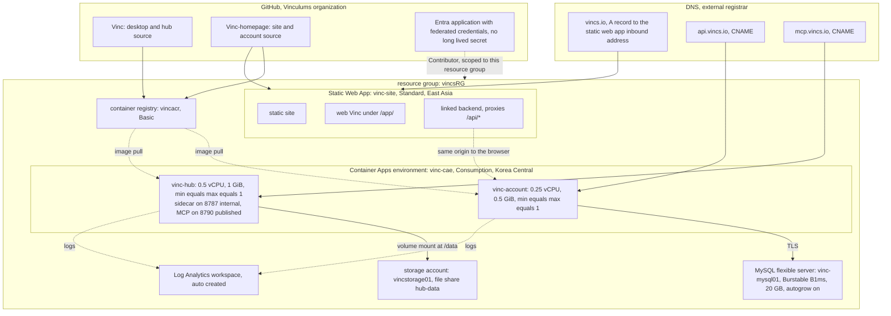

# Cloud infrastructure as built

> What is running and why it has that shape. **Not** how to deploy to it: the procedure, the
> pipelines, the runtime environment list and the rollback reality are [[vinc.ops.deployment]], and
> the money is [[vinc.ops.cost-management]]. This document is the topology and the constraints the
> topology imposes.
>
> Everything here was rebuilt on 2026-07-28 and 2026-07-29, when the previous provider's virtual
> machine and managed database were deleted outright. Any description of a single server with a
> reverse proxy and service units is history, not this system. Resources change faster than this
> file, so the live inventory should be re-read from the resource group before acting on it.

## 1. Three managed services, because a virtual machine was not available

The intended design was the cheapest possible single virtual machine running containers side by
side, at roughly eight dollars a month. It could not be built. This subscription, newly created,
**refused compute provisioning in every region tried**, reporting the size as unavailable for the
subscription while the quota display showed capacity. Two machine sizes across six regions, in
Korea, Japan, Southeast Asia, the United States and Europe, all behaved identically. The likely
cause is new-subscription fraud prevention, and lifting it needs a support request that has not
been filed.

Every other resource provider worked normally. So the deployment moved to managed services:
containers on a consumption environment, a managed relational database, and a static web app with a
linked backend.

This is more expensive than the original plan and it is **not merely a workaround**. The managed
path brought automatic database backups, revision rollback and managed certificates, none of which
the single-machine plan had. If compute is later approved, the cost comparison is worth redoing,
but it is not a straight reversal.

## 2. Topology

## 3. Inventory

| Resource | Type | Size | Region | Purpose |
|---|---|---|---|---|
| `vinc-cae` | Container Apps environment | Consumption | Korea Central | hosts both containers |
| `vinc-account` | Container App | 0.25 vCPU, 0.5 GiB, single replica | Korea Central | account backend |
| `vinc-hub` | Container App | 0.5 vCPU, 1 GiB, single replica | Korea Central | hosted sidecar and MCP server |
| `vinc-mysql01` | MySQL flexible server | Burstable B1ms, 20 GB | Korea Central | account database |
| `vincacr` | Container registry | Basic | Korea Central | container images |
| `vincstorage01` | Storage account | Standard, locally redundant | Korea Central | hub graph persistence over a file share |
| `vinc-site` | Static Web App | **Standard** | East Asia | static site, web Vinc, linked backend |
| Log Analytics workspace | Log Analytics | default | Korea Central | container logs, created automatically |
| two managed certificates | Managed certificate | free | not regional | TLS for the two subdomains |

The static web app is in a different region from everything else because the service is not offered
in Korea Central. It is a content-distributed service, so the region choice does not carry the
latency meaning it would for the containers. The Standard tier is required rather than chosen: the
free tier has no linked backend, which was confirmed by watching an account route return
not-found through the site, and the tier difference is nine dollars a month.

## 4. Names and routes

| Name | Record | Target | Ownership proof |
|---|---|---|---|
| apex | A | the static web app's stable inbound address | a text record on the apex |
| `api.vincs.io` | CNAME | the account container's environment hostname | a text record naming the environment verification id |
| `mcp.vincs.io` | CNAME | the hub container's environment hostname | the same verification id, shared by both containers |

The apex is an A record only because a plain address record is the lowest common denominator. A
registrar that supports alias records at the apex should point at the hostname instead, so the
global distribution is preserved rather than collapsed onto one region's address. The address can
change on reissue, so it should be re-read rather than remembered.

**The database firewall allows all traffic originating inside the cloud.** Container Apps outbound
addresses are dynamic and number in the hundreds, so a per-address allowlist is not expressible.
The consequence has to be stated rather than assumed away: **the account credentials are the only
defense** for that database. Private networking would remove the exposure and has not been done.

## 5. Identity for deployment

Continuous delivery authenticates with federated credentials, so there is **no long-lived secret**
anywhere in the pipelines. Two repositories are registered against one application registration, and
the role assignment is **Contributor scoped to this resource group only**, not to the subscription.

Image pull is separate and does not use that identity: the containers pull with registry
credentials held as container secrets. Two different mechanisms for two different moments, and
confusing them is a common way to misdiagnose a failing deployment.

> **The federated subject is an opaque identifier and must be copied, not composed.** A subject
> written by hand from the repository and branch name fails to match. The 2026-08-05 incident and
> the correct procedure are in [[vinc.ops.deployment]] section 6.1.

## 6. Persistence, and the two things the file share cannot do

The database is managed: backups run daily and are kept for a week, without geographic redundancy.

The hub's graph lives on a **mounted file share**, not on container storage, which is what lets it
survive container replacement and revision changes. That was verified by writing, restarting and
reading the same data back.

Two limits of that share have already caused outages, and both are properties of network file
protocols rather than of this application.

- **Byte-range locking is not reliable on the share.** The authorization state database, a small
  embedded file database, failed on its first schema write when it was placed there, and the
  revision went unhealthy. The resolution is to keep the **working copy on local container storage**
  and copy the committed file to the share as a snapshot, restoring from it at startup. Copying is
  the one operation the share supports without reservation, and the embedding model cache already
  lived that way
- **There are no snapshots configured.** The service supports them; none is enabled. The hub's graph
  therefore has no real backup, in contrast with the managed database beside it

## 7. Constraints the application imposes on the platform

Two of the shapes above are not platform defaults; the application forces them.

**Both containers run exactly one replica.** For the hub this is not tuning: the embedded store
takes an **exclusive file lock**, so two replicas on one share cannot both open it. That single fact
propagates outward. It rules out scaling out, it makes a brief interruption during deployment
unavoidable, and it makes the platform's default replace-then-retire ordering fail, because the
incoming replica cannot open a store the outgoing one still holds. The failure is quiet in the worst
way: the new revision is unhealthy while the old one keeps serving, so the service looks fine and
the deployment did not happen. The ordering that works, and the reason a plain restart cannot
succeed at all, are in [[vinc.ops.deployment]] section 4.3.

**The hub embeds on a lean runtime.** The container ceiling is one gibibyte, and an out-of-memory
kill there would take the MCP server down with the worker, so the embedding worker runs on an ONNX
runtime rather than a tensor framework, at roughly 660 mebibytes instead of 800 or more. The
quantized model is **baked at image build time**, because quantizing at runtime peaks above 1.5
gibibytes and cannot fit. Raising the container size instead would double the always-on charge, so
the runtime choice is also the cost choice.

## 8. Two front doors, one of them accidental

Linking the account container to the static web app has a side effect measured on 2026-07-29:
**the platform turns on its built-in authentication for that container**. Calling the container
hostname directly then answers with an authorization challenge, and only requests arriving through
the static web app pass. It is a security gain, and it restored a boundary the previous reverse
proxy used to provide, but it was nobody's decision.

Two consequences follow, one on each side.

- Anything that probes the container hostname directly, a health check or a monitor, **breaks
  quietly**. A deployment verification step did exactly this and had to be pointed at the site
  hostname
- On 2026-08-04 the same mechanism blocked the hub calling the account's internal key verification
  path, which made every member API key fail with an empty unauthorized response. The tell is that
  the rejection carries a bearer challenge and no body, meaning the front door refused it and the
  application never ran. The account is now the record: [[vinc.ops.incident-2026-08-04-easyauth]]

**The hub has no such door.** It is not linked to the static web app, so its internal paths remain
publicly reachable and a signature check is the only gate in front of them. That asymmetry is
deliberate to the extent that the hub must be reachable by remote connectors, and unexamined to the
extent that its internal paths did not have to be. See [[vinc.ops.risk-audit-2026-08-05]].

## 9. Known gaps

1. **No backup of the hub's file share.** Snapshots are available and not enabled, so the graph is
   protected only by the platform's storage redundancy
2. **Database credential separation is incomplete.** The bootstrap ran as the administrative
   account; the restricted account is intended for subsequent schema changes
3. **The account session cookie declares no domain.** Harmless while the linked backend makes
   everything one origin, and a defect the moment any client calls the account hostname directly
4. **The database is reachable from anywhere inside the cloud**, section 4
5. **The compute restriction has not been appealed.** Section 1 explains why the answer may no
   longer be a virtual machine even if it is lifted
6. **The embedding worker has never loaded its model**, so the hub is running the retrieval half of
   the product on full-text search alone. The container is provisioned for it; nothing about this
   gap is a resource shortage. See [[vinc.plan.embedding-pipeline]]
