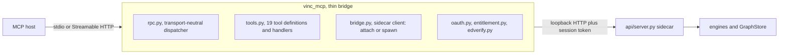

# The MCP server implementation

> [[vinc.canon.mcp-contract]] settles **what** the interface promises. This settles **how** the
> server delivers it: what the module contains, which transports it speaks, how it finds or starts
> a sidecar, how a host registers it, and which parts of the original skeleton did not survive
> contact with the code.
>
> `Vinculums/Vinc` `vinc_mcp/` is the authority. This document was reconciled against it on
> 2026-08-06, and the reconciliation changed a good deal: the original was a design skeleton that
> had been overtaken by three separate implementation passes and still described a framework
> dependency, a package layout and a lifecycle that no longer exist.

## 1. The server carries no business logic

The module is a bridge. It validates the shape of a call, forwards it to the sidecar over HTTP, and
returns the answer. There is no meaning judgment, no structuring and no de-duplication in it,
because all three already live elsewhere: upstream in the host, downstream in the engines.

That is not modesty, it is the property that makes the second front door safe. A tool that
interpreted its arguments would become a second, divergent implementation of the graph contract,
and the two would disagree the first time either changed. Being a thin bridge is why the MCP door
and the app door cannot drift apart.

## 2. What the package actually contains

| Module | Role |
|---|---|
| `rpc.py` | JSON-RPC dispatcher, shared by both transports |
| `stdio.py` | newline-delimited transport, for a locally registered host |
| `http_server.py` | Streamable HTTP transport, plus the web proxy operation map |
| `tools.py` | the tool registry and handlers. **The authority for the tool list** |
| `bridge.py` | the only downstream surface: an HTTP client for the sidecar |
| `install.py` | host registration automation |
| `oauth.py` | the authorization gate for the remote profile |
| `entitlement.py` | member API key verification against the account |
| `edverify.py` | signature verification for the account-to-hub assertions |
| `store.py` | persistence for authorization state, clients, tokens and quota |
| `remote.py` | the desktop client for `target: remote` |
| `syncclient.py` | the remote adapter used by document and node synchronization |

Three things follow from that list. There is **no lifecycle module** and **no audit module**;
sections 4 and 6 explain what happened to each. And the package is named `vinc_mcp`, not `mcp`: the
top-level name `mcp` would shadow the official Python SDK package during import, since the
repository root is on the module path. The rename exists purely to avoid that collision.

**The dispatcher implements the minimum server surface**: initialize, initialized, ping, list and
call. Anything else answers with method-not-found. A tool failure comes back as a result marked in
error rather than as a protocol error, which is what the specification asks for and what lets a
host correct and retry instead of tearing down the session.

## 3. Two transports over one core

Local hosts speak stdio. Remote connectors speak Streamable HTTP. Both wrap the same dispatcher and
the same tool handlers, so there is exactly one implementation of every tool.

Streaming is not offered: a request for a stream is answered with method-not-allowed, which the
specification permits. Every tool here is a single request and a single response, so a stream would
add a code path with no benefit.

**The framework dependency is gone.** The original design specified the official server framework
and an optional install extra to carry it. The implementation uses the standard library instead.
The reasons were external-dependency count, symmetry with the sidecar's own standard-library HTTP
server, and a frozen-binary measurement showing no size increase. The extra is no longer needed.

Authorization for the HTTP transport is section 4 of [[vinc.spec.remote-profile]]. Two facts belong
here because they are properties of the server rather than of the deployment: it **refuses to start
with no authentication configured at all**, so an unauthenticated public exposure cannot happen by
omission, and protocol version negotiation answers an unrecognized requested version with the
**latest** supported rather than falling back, because falling back would silently downgrade a host
that negotiates a newer revision.

## 4. Finding a sidecar: attach first, otherwise start one

The bridge attaches to a running sidecar if there is one and starts one if there is not, and it
terminates only a process it started itself.

The original design specified a lock file holding a process id, port, token and a reference count
shared with the desktop shell, so that whoever needed the sidecar first would start it and whoever
left last would stop it. **That was reduced.** What shipped keeps only the safe half: no reference
count, no shared ownership, and no risk of one client stopping a sidecar another is using. Reference
counting comes back when the shell and the MCP server actually need to share one process, and until
then it would be machinery maintained for a case that does not occur.

**The port is not fixed.** The bridge takes an operating-system-assigned free port and the sidecar
binds to it. Pinning 8787 was abandoned because a stale sidecar holding the port turned every
subsequent start into a confusing failure. Any text that still says the local MCP path uses 8787 is
describing the earlier arrangement.

## 5. Registration: two conventions, one module

Automatic registration is `vinc mcp install --client <host>` and there are only ever two shapes to
it, both absorbed by `install.py`.

- **Delegate to the host's own command line tool** when it has one, and when it is absent, print
  the command for the user to paste rather than failing
- **Merge into the host's JSON configuration**, writing only our own key and **backing the file up
  first**, so an unrelated entry in the same file is never lost

Four clients are wired today. A host outside that set is not unsupported: `vinc mcp manual` prints
the snippet to paste, and the server behaves identically once registered. Only the automation is
missing, which is the distinction [[vinc.canon.mcp-contract]] section 8 draws between the contract
and the registration conventions around it.

A remote connector is registered by URL, once, by hand. That is not a gap to close: a loopback
address is structurally unreachable from a remote host, so there is nothing to automate.

## 6. The call log has still not been built

The design specified an append-only log of every tool call, one line each, with a digest of the
arguments rather than their content, feeding an observation panel under settings.

It is **not implemented**, and there is no audit module in the package. The reason it stayed open is
that the log schema was to be settled by the panel that consumes it, and that panel has never been
designed. The dependency was stated in the original and it held.

The consequence should be named plainly: today a user cannot see what a host wrote through MCP
except by looking at the graph afterwards. The safety annotations in
[[vinc.canon.mcp-contract]] section 4.2 mitigate this at the moment of the call, by letting a host
prompt before a destructive write, but they leave no record.

## 7. De-duplication is exact match, permanently

The only backstop is an exact string identity merge. Vector similarity, fuzzy matching and
model-judged de-duplication are **permanently excluded**, for three reasons that have not weakened:
the original engine was exact-match and adding similarity would make Vinc an interpreter rather than
a store; the responsibility would collide with the read-before-write covenant, which already places
it upstream; and folding two ids that mean the same thing is a decision a person should make.

The reversal path exists instead, in the candidate-proposal and node-merge tools. This is the
implementation-side statement of the same rule that [[vinc.canon.mcp-contract]] section 3 states as
contract.

Because the driver does not report whether a merge created or matched, the counts come from a
membership check issued **before** the merge, at two queries per node. That is measurable overhead
only at a scale conversational fragments do not reach.

## 8. What the reconciliation corrected

| Claim in the original | As built, 2026-08-06 |
|---|---|
| Five tools, later seven, later eighteen | **Nineteen**, thirteen read and six write. The registry is the authority |
| The official server framework, behind an install extra | Standard library JSON-RPC. The extra was removed |
| Package `mcp/` | `vinc_mcp/`, to avoid shadowing the official SDK package |
| Lock file with a reference count shared with the shell | Attach or start, terminate only what we started |
| Fixed loopback port 8787 | Operating-system-assigned free port for the spawned local sidecar |
| Subgraph traversal not backed by any query | Implemented. Seed and depth traversal is live |
| Record nodes, free-form properties and inheritance edges unsupported | All three supported. The schema grew the columns and the tables |
| A type enumeration validated at the tool boundary | Withdrawn. Types resolve against the theme vocabulary and an unknown type is folded in as proposed, never skipped |
| Names inherited from a graph database this project does not use | Renamed with history preserved. The store is the embedded engine of `adr-engineering-014` |
| Call log with a defined schema | Not implemented, section 6 |

Two of these deserve a note beyond the table. The type enumeration was not simply relaxed: it was
**replaced by a different model**, in which the vocabulary is user-authored per theme and the
physical binding is a routing table rather than a gate. That is [[vinc.canon.vocabulary-model]], and
the routing is [[vinc.spec.dataplane]] section 3. And the write surface is six tools, not one; the
audit boundary is the annotations and owner stamping, not the count.

## 9. Open

- The call log and the panel that consumes it, section 6
- Whether a host may ingest on its own initiative by default, or should ask
- Pull-style mining of past conversation history. The hard part is provenance, not extraction

**Closed since the original.** Packaging is done: the frozen sidecar bundle declares the MCP
modules as hidden imports, so the desktop binary carries the server rather than requiring a
separate one. That mattered more than it sounds, because this package is imported dynamically and
static analysis alone would have dropped it silently from the bundle.
